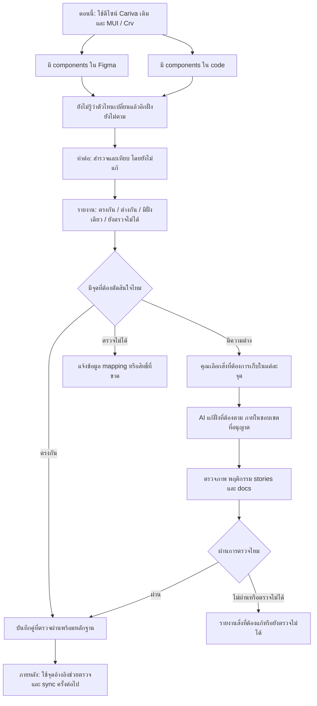

# Cariva DS — สถานะและ flow ดูแล components

บันทึกวันที่ 24 พฤศจิกายน 2026

## สิ่งที่ตกลงแล้ว

- ใช้ MUI และ Crv components เดิม ยังไม่เปลี่ยนเป็น shadcn
- ใช้ดีไซน์ Cariva เดิม รวมสี มุมโค้ง และฟอนต์ตาม Product Style
- ต้องการปรับ components ก่อนขยายไปทำหน้าจอและ board
- มี components ทั้งใน Figma และ code แต่ยังไม่ทราบว่าตัวไหนเปลี่ยนแล้วอีกฝั่งยังไม่ตาม
- ยังไม่ได้สำรวจความตรงกันครบ และยังไม่มีระบบ parity/sync อัตโนมัติที่ตรวจยืนยันแล้ว

## ภาพรวม

## งานถัดไปที่เสนอ — ยังไม่ได้เริ่ม

เริ่มสำรวจแบบอ่านอย่างเดียวจากกลุ่มเล็ก เช่น Button, Input และ Select โดยตรวจว่ามี component ใดในระบบจริงก่อน ไม่ถือว่าชื่อที่ยกตัวอย่างมี implementation ครบแล้ว

1. รวบรวม code exports, Figma nodes และ Code Connect mappings ที่เกี่ยวข้อง
2. เทียบ props, variants, states, tokens และภาพจาก preview ที่รันจริง
3. รายงานแต่ละคู่พร้อมหลักฐานและขอบเขตที่ตรวจ
4. ให้ผู้ใช้ตัดสินเฉพาะจุดที่ต่างหรือมีความหมายกำกวม ก่อนแก้ฝั่งปลายทาง
5. ตรวจผลหลังแก้ และบันทึกจุดอ้างอิงของคู่ที่ตรวจผ่าน

| สถานะ | ความหมาย |
|---|---|
| ตรงกัน | สิ่งที่ตรวจทั้งสองฝั่งตรงกัน ภายในขอบเขตที่ระบุ |
| ต่างกัน | พบความต่าง แต่ยังไม่สรุปว่าฝั่งใดควรตามอีกฝั่ง |
| มีฝั่งเดียว | พบ component ในฝั่งหนึ่ง และยังไม่พบคู่หลังค้นในขอบเขตที่เข้าถึงได้ |
| ยังตรวจไม่ได้ | ขาด mapping, เข้าถึงไม่ได้ หรือยังตรวจ runtime/ภาพไม่ได้ |

การไม่มี baseline เดิมทำให้ยังสรุปไม่ได้ว่าใครเปลี่ยนอะไรล่าสุดอย่างน่าเชื่อถือ วันที่แก้ไฟล์เพียงอย่างเดียวไม่ใช่เหตุผลให้เขียนทับอีกฝั่ง

## Flow ที่ต้องการให้ automate มากขึ้น — ยังไม่ได้สร้าง

เมื่อมีจุดอ้างอิงที่ตรวจผ่านแล้ว งานแก้ component ครั้งต่อไปควรรวมการตรวจอีกฝั่ง การ sync ตามทิศทางที่ได้รับอนุญาต การตรวจ stories/ภาพ/docs และการบันทึกสถานะไว้ในงานเดียว

- เก็บ source path/commit, Figma file/node, mapping และหลักฐานที่ใช้ตรวจ โดยระบุ dirty source หรือข้อมูลที่ยังไม่ครบ
- ถ้าสองฝั่งเปลี่ยนส่วนเดียวกัน ให้แสดง conflict ก่อนเขียนทับ
- การตรวจผ่านหมายถึงเฉพาะสิ่งที่มีหลักฐาน ไม่ใช่การรับประกันทุก behavior หรือทุก state
- การตรวจตามเวลาหรือทุก PR ต้องพัฒนา automation/CI เพิ่ม การติดตั้ง skill ไม่ได้ทำให้เกิด background sync
- จุดอ้างอิงและ Git history ไม่ใช่การเริ่มเลขเวอร์ชัน DS ช่วงนี้ยังเป็น Draft

## สิ่งที่ไม่ได้ทำใน artifact นี้

ไฟล์นี้บันทึกสถานะและข้อเสนอเท่านั้น ไม่ได้เริ่ม audit, แก้ components/tokens, sync Figma, publish library หรือสร้างระบบ board/playground/automation

อ้างอิงบริบท: การตัดสินใจล่าสุดในแชตนี้ และ `DESIGN-SYSTEM-PLAN.md` โดยข้อเลือก MUI และดีไซน์ Cariva เดิมล่าสุดมีผลเหนือแนวทดลอง shadcn/BWC ในแผนก่อนหน้า
