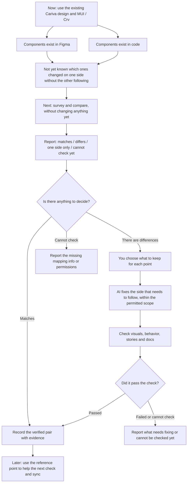

# Cariva DS — Status and flow for maintaining components

Recorded on 24 November 2026

## What has been agreed

- Use the existing MUI and Crv components; do not switch to shadcn yet
- Use the existing Cariva design, including colors, corner radius and fonts per the Product Style
- Components need to be adjusted first, before expanding to screens and the board
- Components exist in both Figma and code, but it is not yet known which ones have changed on one side without the other following
- The match between the two sides has not been fully surveyed, and there is no verified automatic parity/sync system yet

## Overview

## Proposed next work — not started

Start a read-only survey with a small group, such as Button, Input and Select, first checking which components actually exist in the system. Do not assume the example names already have a complete implementation.

1. Gather the relevant code exports, Figma nodes and Code Connect mappings
2. Compare props, variants, states, tokens and visuals from a preview that is actually running
3. Report each pair with evidence and the scope that was checked
4. Have the user decide only on points that differ or are ambiguous, before changing the target side
5. Verify the result after the fix, and record a reference point for each pair that passes

| Status | Meaning |
|---|---|
| Matches | What was checked on both sides matches, within the stated scope |
| Differs | A difference was found, but it is not yet concluded which side should follow the other |
| One side only | The component was found on one side, and no counterpart was found after searching within the accessible scope |
| Cannot check yet | A mapping is missing, access is unavailable, or runtime/visuals cannot be checked yet |

Without an existing baseline, it is still not possible to reliably conclude who changed what most recently. A file's modification date alone is not a reason to overwrite the other side.

## Flow we want to automate more — not yet built

Once there is a verified reference point, the next component fix should combine checking the other side, syncing in the permitted direction, checking stories/visuals/docs, and recording the status in a single piece of work.

- Keep the source path/commit, Figma file/node, mapping and evidence used for the check, noting any dirty source or incomplete information
- If both sides changed the same part, show the conflict before overwriting
- A passed check covers only what has evidence; it is not a guarantee of every behavior or every state
- Checks on a schedule or on every PR require additional automation/CI development; installing a skill does not create a background sync
- A reference point and Git history are not the start of DS version numbering; for now it is still a Draft

## What this artifact does not do

This file records status and proposals only. It does not start an audit, change components/tokens, sync Figma, publish a library, or build a board/playground/automation system

Context references: the latest decision in this chat, and `DESIGN-SYSTEM-PLAN.md`, where the latest choice of MUI and the existing Cariva design takes precedence over the shadcn/BWC experimental approach in the earlier plan
