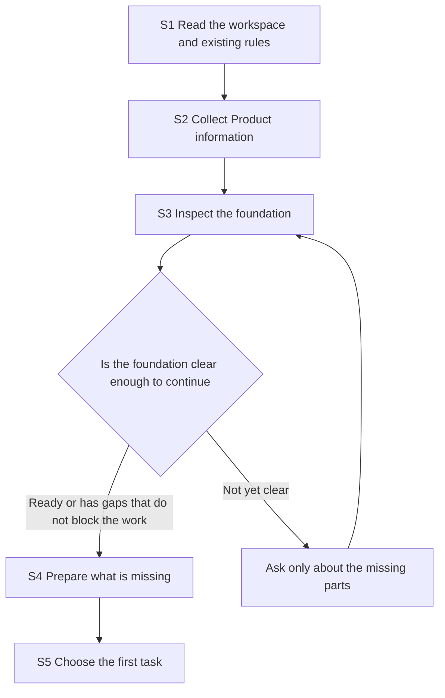
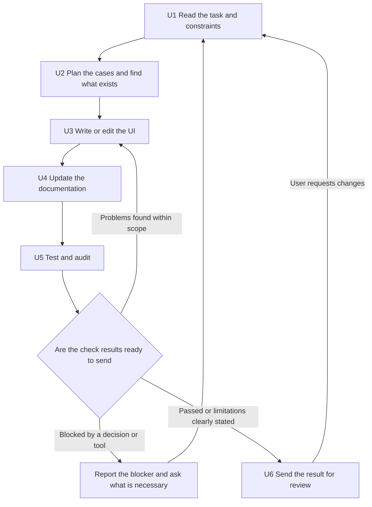
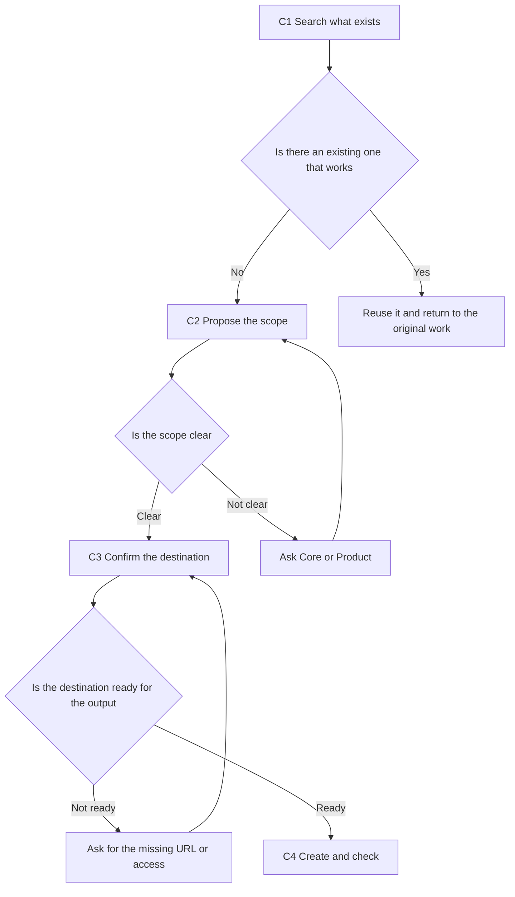
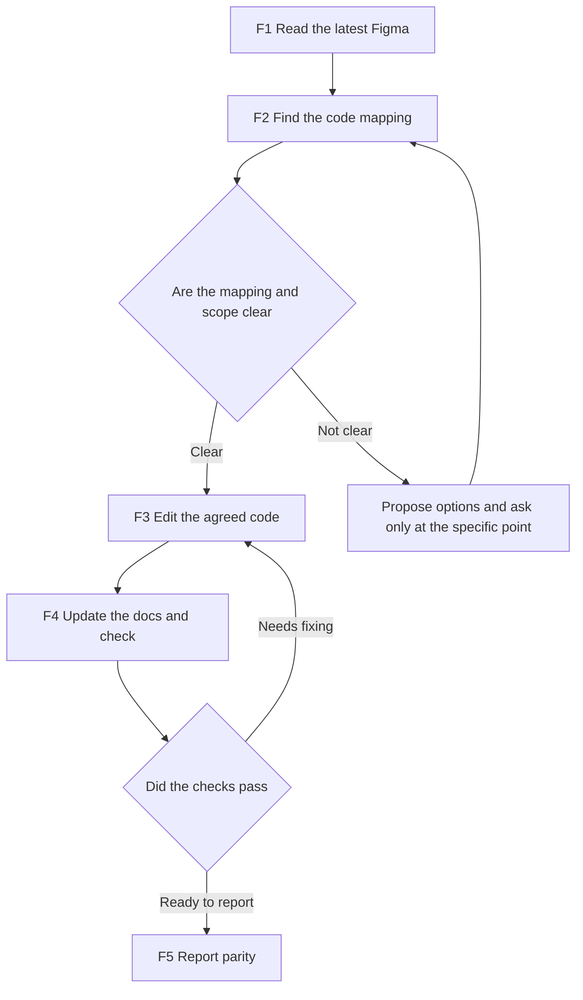
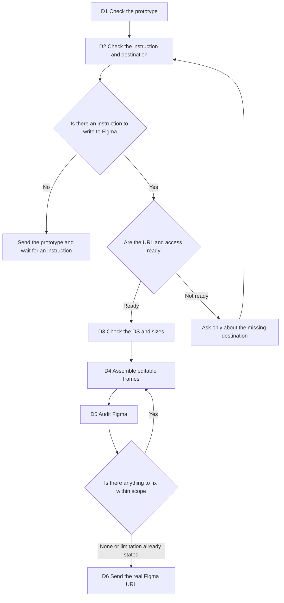
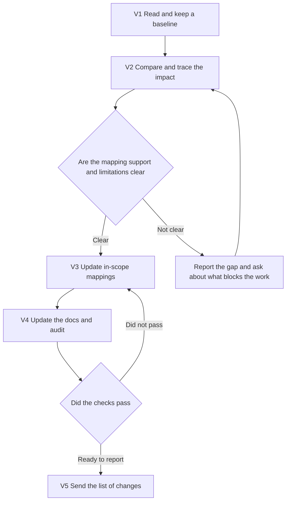
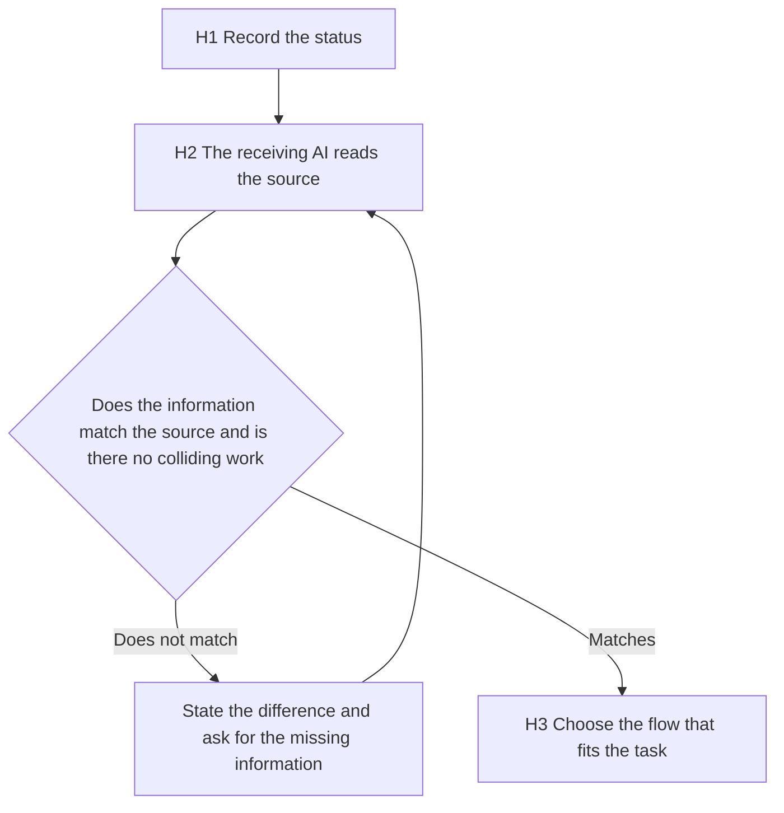

# Workflow map and the rules for each step

Updated 26 November 2026 for designers and for both AIs, Codex/Claude, to read before choosing work in an existing or new project.

Read from top to bottom: rectangle = task, diamond = condition, text on a line = choice. The step codes match the tables below. The tables are a text description for when the renderer does not display Mermaid.

## Shared rules

- This document owns the order and the decision gates; the specialist files hold the implementation details. Read them together. If they conflict with the user's latest instruction or the workspace rules, disclose the conflict instead of silently choosing one
- "Ask/wait" stops only the work that depends on the answer. Independent authorized work may continue. Silence is not approval. Do not ask again when there is an answer that is still valid
- Report missing tools/access truthfully. Do not bypass permissions, invent props/mappings/URLs, or say a check step passed. You may use the result "could not check" and send a partial status, but never call the work complete
- Failures within scope must be fixed before finishing. If blocked by a problem outside scope, send the result with the blocker and what has been done, and do not skip a gate to claim success
- A request for changes/feedback goes back into the same flow with the previous constraints. Approving the appearance does not automatically authorize publishing or a Figma write

## Choose a flow

| Task | Read section | Supporting details |
|---|---|---|
| Start a project/Product | Setup | project-guide.md and ds-foundation.md |
| Create/edit UI or Canvas | UI | ui-workflow.md |
| A new component is needed | Component | ds-foundation.md and figma-workflows.md |
| Figma changed, so change the code | Figma → Code | figma-workflows.md |
| Take a prototype to Figma | Code → Figma | figma-workflows.md |
| Change variables | Variables | figma-workflows.md |
| Change the AI doing the work | Handoff | TASK-HANDOFF.md |

## Project setup

**Starts when:** a new workspace or Product is started

| Step | To do | Result and condition to continue |
|---|---|---|
| S1 Read the workspace and existing rules | Inspect the source, working changes, Product records and the latest instructions | Know whether this is an existing or a new project. Never scaffold over existing work |
| S2 Collect Product information | Ask only for the Product name and the central DS / Product DS / design file URLs that are still missing | Store each Product separately; "not yet created" and "central only" are valid answers |
| S3 Inspect the foundation | Read ds-foundation.md; inspect the code base, DESIGN.md, tokens, docs, stories, mapping and tools | Separate present / missing / inaccessible. If the stack is unclear, propose and ask |
| S4 Prepare what is missing | Do only the scaffolding that is authorized; do not create the whole component set | There is a readiness summary and clearly stated blockers |
| S5 Choose the first task | Ask for the page or flow and the design/code direction after summarizing readiness; use an earlier answer if there is one | Ready to enter the UI or Figma flow; stop only the work that depends on a blocker |

## Create and edit UI

**Starts when:** asked to create a page, change the appearance, or refactor UI

| Step | To do | Result and condition to continue |
|---|---|---|
| U1 Read the task and constraints | Identify the Product, the code/Figma/docs scope, the visual authority and what must not change | May edit the permitted work; sending to Figma is not automatic |
| U2 Plan the cases and find what exists | Separate confirmed/proposed/unresolved; check the real components and props | There is a case list and a reuse plan; a missing component goes into the component flow |
| U3 Write or edit the UI | Use the existing tokens/contracts; keep mock data separate from real business rules | There is a prototype to check; do not change Core more broadly than the scope |
| U4 Update the documentation | Check the related Markdown, Storybook and Figma docs; update the destinations within scope | State what was updated and what is pending; a description does not replace the on-canvas doc |
| U5 Test and audit | Check render, states, keyboard, responsive, reuse and the real checks | If an error within scope is found go back to U3; if a decision is needed, ask |
| U6 Send the result for review | Send the latest preview/review with the check results and limitations | Do not claim everything passed when there are fails/unverified items; feedback goes back to U1 |

## Add a component

**Starts when:** the existing reuse or composition does not meet the need

| Step | To do | Result and condition to continue |
|---|---|---|
| C1 Search what exists | Search Core, then Product, and check the real variants/subcomponents | If an existing one works, finish with reuse and do not create a duplicate |
| C2 Propose the scope | Recommend Core or Product with reasons about shared use and the domain | Do not promote Product to Core on your own; if unclear, ask |
| C3 Confirm the destination | If writing to Figma, there must be an agreed destination DS URL; code-only uses the source path | An earlier answer may be reused; check access before writing; if there is no URL yet, wait only for the Figma part |
| C4 Create and check | Do the necessary subset, then go through U4/U5 and a Figma audit if writing | There are docs/checks/the actual node URL, or the real limitations are stated |

## Figma → Code

**Starts when:** the user gives a URL and asks to implement or sync on the code side

| Step | To do | Result and condition to continue |
|---|---|---|
| F1 Read the latest Figma | Check the node, main component/override, variants, bindings and layout | Know the real source and scope; if there is no access, report it, do not guess |
| F2 Find the code mapping | Search for the equivalent and compare role/variant/size/behavior | If the mapping is unclear, propose then ask; do not treat the same name as meaning a match |
| F3 Edit the agreed code | Edit the consumer or Core according to the scope; do not push old code over Figma | Keep the approved API; a new API or business rule outside scope must be agreed |
| F4 Update the docs and check | Use U4/U5 to test and compare the render with the requested Figma | Problems within scope go back to F3; conflicts go back to F2 |
| F5 Report parity | State what matches / still differs / could not be checked, with evidence | Do not call it a complete sync if there is still a gap |

## Code → Figma

**Starts when:** the prototype has passed review and the user asks to write to Figma

| Step | To do | Result and condition to continue |
|---|---|---|
| D1 Check the prototype | Read the source/render and the latest U4/U5 results; do not guess from old images | There is a code audit; if it has not passed, fix within scope first |
| D2 Check the instruction and destination | Check that a Figma write was really requested; read the Product record, separating central DS / Product DS / design file | With no instruction, end at the preview; if a URL is missing, ask then wait |
| D3 Check the DS and sizes | Check the actual library access, instances and the approved desktop/tablet + mobile widths | A missing component goes into the component flow; if sizes are not agreed, propose and ask |
| D4 Assemble editable frames | Use actual DS instances/variables/Auto Layout for the agreed pages or states | Do not substitute a screenshot or a detached lookalike; do not publish the library on your own |
| D5 Audit Figma | Check linkage, tokens, variants, layout and the visual comparison against the prototype | Problems within scope go back to D4; report any unsupported linkage |
| D6 Send the real Figma URL | State the nodes created/edited, the sizes, interaction limitations and gaps | Finish when there is check evidence; do not treat the code audit as a substitute for the Figma audit |

## Change Figma variables

**Starts when:** the user says variables were changed and asks to update the consumers

| Step | To do | Result and condition to continue |
|---|---|---|
| V1 Read and keep a baseline | Read the accessible collections/modes/types/aliases and compare with the snapshot before overwriting | Do not delete the old baseline; if there is no baseline, report that this is the first time |
| V2 Compare and trace the impact | Separate new changes from historical drift; find the mappings and consumers | A value that is unsupported or conflicts with a constraint requires asking at the specific point |
| V3 Update in-scope mappings | Use the project's real generator; do not edit generated files by hand | Do not guess a missing mapping; do not claim a snapshot equals parity |
| V4 Update the docs and audit | Check the affected docs/stories/render together with regression checks | Fail goes back to V3; report unknowns, and do not create a background watcher |
| V5 Send the list of changes | State the old/new values, consumers, check results and unmapped gaps | Finishes only within the confirmed scope |

## Hand work over to an AI

**Starts when:** the person doing the work changes or the work is sent to another repository

| Step | To do | Result and condition to continue |
|---|---|---|
| H1 Record the status | Fill in TASK-HANDOFF.md with Product/scope/constraints/actual checks/pending | Do not include secrets; do not claim a check passed without evidence |
| H2 The receiving AI reads the source | Read the entry rules and working changes; compare the report with the real status | If there is a conflict/colliding work, ask only about that part; do not overwrite |
| H3 Choose the flow that fits the task | Enter the setup/UI/Figma flow according to the current request | Do not resume paused work; do not treat a handoff as permission to publish |

