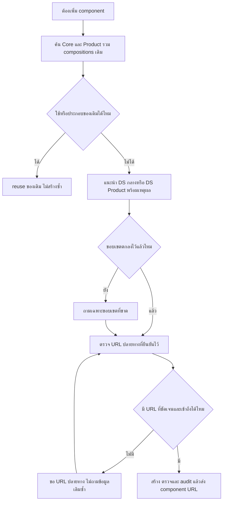
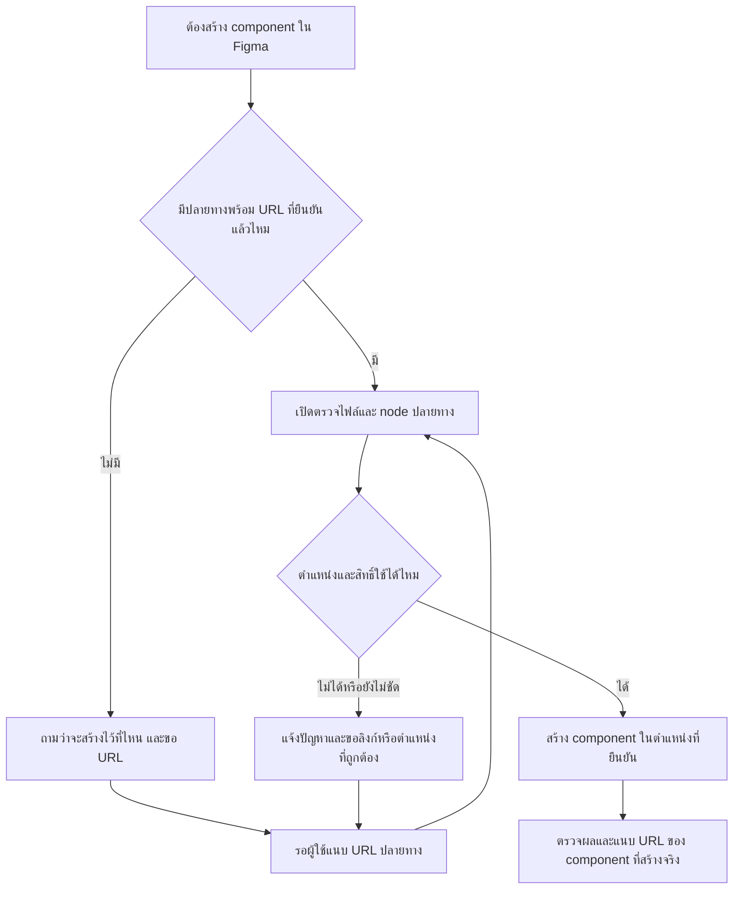
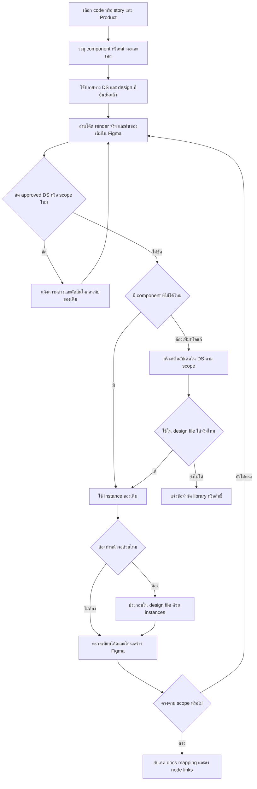

# Flow: Code → Design ใน Figma

ใช้เป็นแขนงของ [UI workflow](ui-workflow.md) สำหรับนำ component หรือหน้าจอจากโค้ดไป Figma ไม่ใช่การเริ่ม migrate หรือ sync ทั้งระบบ โดยใช้กฎกลางและขั้น docs/tests/audit เดิม

## ตัวอย่างคำสั่ง

> นำ component และหน้าจอนี้จากโค้ดไป Figma ของ Product A ใช้ไฟล์ DS [ลิงก์] กับไฟล์ design [ลิงก์] อัปเดตของเดิมก่อน ไม่ลบของเก่า แล้วตรวจเทียบกับโค้ด

ระบุ “เฉพาะ component ใน DS” หรือ “เฉพาะหน้าจอใน design file” ได้ ไม่จำเป็นต้องเขียนทั้งสองไฟล์ทุกรอบ ใช้ปลายทางที่ยืนยันไว้ในงานเดิม ไม่ถามซ้ำหากชัดเจน และอย่าเดา design file จาก DS file

## ลำดับงาน

### ก่อนเพิ่ม component: เช็กของเดิมและเลือก DS

1. ค้น component และ compositions เดิมใน DS กลางและ DS Product ก่อน ทั้ง mapping ฝั่งโค้ดและ Figma ที่เกี่ยวข้อง หาก reuse หรือประกอบได้ ให้ใช้ของเดิม ไม่เริ่มสร้างชุดซ้ำ
2. หากต้องเพิ่มจริง AI แนะนำขอบเขตพร้อมเหตุผล: **DS กลาง/Core** สำหรับชิ้นส่วนที่ใช้ร่วมโดยไม่ผูก domain เฉพาะ หรือ **DS Product** สำหรับข้อมูล/behavior เฉพาะผลิตภัณฑ์ ไม่ตัดสินจากรูปลักษณ์คล้ายกันเพียงอย่างเดียว
3. ใช้ขอบเขตและ URL ที่ตกลงไว้แล้วในงาน/Product นั้นโดยไม่ถามซ้ำ หากยังไม่ชัด ให้ถามเฉพาะสิ่งที่ขาด พร้อมขอ URL ของ page/frame/section ปลายทางก่อนเขียน ไม่เดาว่าไฟล์ DS กลางคือไฟล์ DS Product
4. ตัวอย่างคำถาม: “ตัวนี้มีข้อมูลเฉพาะงานแล็บ แนะนำไว้ใน DS Product A ค่ะ ต้องการใช้ขอบเขตนี้ไหม และจะสร้างที่ไหนใน Figma? แนบ URL ปลายทางได้เลย” หากมีขอบเขตหรือ URL แล้วให้ตัดส่วนที่ทราบออกจากคำถาม
5. เมื่อปลายทางยืนยันและเข้าถึงได้จึงสร้าง จากนั้นตรวจ/audit และส่ง URL ของ component จริงตามขั้นเดิม การเพิ่มใน code-only ใช้การตัดสิน Core/Product เช่นเดียวกัน แต่ไม่บังคับขอ Figma URL เมื่อไม่ได้ขอ Figma output

แผนภาพส่วน URL ใช้สำหรับงาน Figma; code-only ตรวจ source path ตาม Product แทน สถานะ Mermaid source ยังไม่ผ่านการ render ในปลายทางจริง

### จุดตรวจบังคับสองฝั่ง

- **ก่อนนำโค้ดไป Figma:** ทดสอบและทำ Component Audit ฝั่งโค้ดตาม UI workflow รวม docs/Storybook และ consumers ที่ได้รับผล ให้ผู้ใช้ทดลองและอนุมัติก่อน เมื่อผู้ใช้สั่งนำไป Figma จึงเริ่มเขียนปลายทางนั้น หากมีหลักฐานตรวจล่าสุดที่ตรงกับ source เดิมใช้ต่อได้ ไม่ต้องรันซ้ำโดยไม่มีการเปลี่ยนแปลง
- **หลังประกอบใน Figma:** ตรวจ component/instance linkage, variable bindings, naming, variants/states, auto-layout/constraints และเทียบ render กับเว็บต้นแบบใน frames desktop/tablet และ mobile ตาม scope ใช้สกิล audit สำหรับ bindings/naming และสกิล Figma ที่ตรงงานเพื่ออ่าน/render/เทียบ ไม่ถือว่า Component Audit ของ React ตรวจ Figma ให้แล้ว
- พบความต่างให้แก้ใน scope และตรวจซ้ำก่อนส่ง node links พร้อมผล ผ่าน / ต้องแก้ / ตรวจไม่ได้ ระบุข้อจำกัดที่ค้าง ห้ามรายงาน parity ครบจากการตรวจโค้ดเพียงฝั่งเดียว

1. ระบุ workspace/Product, source component/story/screen และเคสที่จะนำไป ตรวจว่า code เป็น approved version หรือ draft ไม่ promote experiment เข้า library เอง
2. ระบุ output: editable Figma Design layers/components หรือ runnable code ซึ่งเป็นคนละผลลัพธ์ ถ้าผู้ใช้ต้องการ component library ให้ใช้ component/instance จริง ไม่แทนด้วย screenshot หรือ Code Layer แล้วอ้างว่าแก้ component ใน Design ได้
3. ตรวจ source, props/variants, tokens, stories และ rendered UI จริงตามขอบเขต ไม่ใช้ screenshot อย่างเดียวอนุมาน behavior หรือ API ทำตามสกิล Stories เมื่อเปิด/ตรวจ stories
4. ก่อนสร้าง component ให้ระบุปลายทางที่ผู้ใช้ยืนยันพร้อม URL จริง หากยังไม่มี ให้ถามว่า **“ต้องการสร้าง component นี้ไว้ที่ไหนใน Figma คะ? กรุณาแนบ URL ของ page/frame/section ปลายทาง”** ใช้ URL ที่มี node-id เมื่อผู้ใช้ต้องการตำแหน่งเฉพาะ หากมีเพียง file URL และยังเลือกตำแหน่งไม่ได้ ให้ถามต่อเฉพาะ page/frame/section ที่ขาด ไม่เดา node หรือเริ่มสร้างใน selection ปัจจุบันเอง ใช้ mapping/บริบทเดิมที่ยืนยันพร้อม URL ได้โดยไม่ถามซ้ำ แต่ถ้ามีหลายปลายทางที่ขัดกันต้องถามก่อนเขียน งานเฉพาะหน้าจอไม่อนุญาตแก้ library โดยอัตโนมัติ
5. อ่านสกิล Figma ที่ตรงผลลัพธ์ก่อนใช้เครื่องมือ: library สำหรับสร้าง/แก้ component, generate-design สำหรับ composed screens และ use สำหรับ Plugin API; code-workflows เมื่อเป็นการ import code ตามขอบเขตสกิล หากขอสร้างไฟล์ใหม่ให้อ่าน create-new-file ก่อนสร้าง
6. ค้น components/variables/styles เดิมใน Figma และ mapping ไปโค้ดก่อน ตรวจ main components, variants และ instance overrides ไม่สร้างชุดซ้ำจากชื่อที่ต่างเล็กน้อย
7. เทียบ code กับ approved Figma DS ถ้าขัดกันให้แยกสิ่งที่ขอเปลี่ยนกับ drift เดิม การสั่ง code → design ไม่อนุญาตเอา hardcode หรือบั๊กในโค้ดไปทับ approved tokens เงียบ ๆ
8. ถ้า component มีอยู่และเพียงพอ ให้ reuse instance ถ้าต้องปรับ component ภายใน scope ให้อัปเดต main component/variants เดิม ถ้ายังไม่มีและงานอนุญาต ให้สร้าง reusable parts ก่อนประกอบ ไม่ลบ library เดิมหรือเพิ่ม props ที่ผู้ใช้ห้าม
9. ใช้ variables/styles และ approved geometry/state recipes ตรวจ auto-layout, sizing, constraints และการย่อขยาย รักษา purple dashed outline ของ component set ตามกฎกลาง
10. เมื่อมี design file อีกไฟล์ ตรวจว่า library/components ใช้งานข้ามไฟล์ได้จริงหรือไม่ หากต้อง publish library, มีข้อจำกัดสิทธิ์ หรือเครื่องมือ import ไม่ได้ ให้รายงานและขอการดำเนินการที่จำเป็น ไม่ publish เองหรืออ้างว่า copy local เป็น linked library แล้ว
11. ประกอบหน้าจอด้วย instances และ compositions ที่นำกลับมาใช้ได้ แยกเคสที่อยู่ใน scope และตั้งชื่อชัดเจน ไม่แตกทุก flow/state อัตโนมัติ หากต้องการ flow หลายสถานะให้ใช้ prototype-to-figma ตามขอบเขตที่ตกลง
12. ตรวจ render และโครงสร้างเทียบ code/story สำหรับเคสที่เลือก รวมข้อความไทย, dimensions, typography, icons, tokens, layout และ responsive constraints การ resize frame ได้ไม่พิสูจน์ว่า responsive ครบทุก breakpoint
13. อัปเดต docs/mapping ที่ได้รับผลจริง ส่ง node links, รายการ reuse/สร้าง/แก้ และความต่างที่ค้าง แยก visual parity, variable binding, component linkage และ prototype behavior ไม่เรียกรวมว่า sync ครบ

## ภาพรวม

### จุดถามปลายทางก่อนสร้าง component

ใช้กับทุกงานสร้าง component ใน Figma รวมงานที่เริ่มจากคำอธิบาย ไม่จำกัดเฉพาะ Code → Design ต้องได้คำตอบและตรวจ URL ก่อนขั้นที่เขียนปลายทางนั้น ระหว่างรอสามารถอ่านโค้ดและวาง anatomy/variants ต่อได้ เมื่อส่งงานให้แนบ URL ของ component/component set ที่สร้างจริง ไม่ใช้ URL ปลายทางเดิมแทนหลักฐานว่ามี component ใหม่แล้ว

ผู้อ่าน: ทีม DS และ AI ทั้งสอง / คำถาม: โค้ดจะกลายเป็น reusable Design ใน Figma ได้อย่างไร / อ่านจากบนลงล่าง เงื่อนไขอยู่บนลูกศร ตารางและขั้นตอนเป็นข้อความสำรอง

## ขอบเขตและข้อจำกัด

ข้อตกลงล่าสุด 25 พฤศจิกายน 2026: หน้าจอ/เคสที่ตกลงให้นำไป Figma ใช้ **2 ขนาดตัวแทน** คือ **desktop/tablet 1 ขนาด + mobile 1 ขนาด** ไม่แยก desktop กับ tablet เพิ่มเป็นสามขนาด ไม่ได้หมายถึงทำสองเฟรมรวมทั้งโปรเจกต์ และไม่ได้อนุญาตแตกทุก state โดยอัตโนมัติ ใช้ความกว้างที่ยืนยันไว้ใน Product/reference ก่อน หากยังไม่มีให้เสนอและยืนยัน ไม่ถือว่าผู้ใช้เลือกค่า px แล้ว ส่วนเว็บต้นแบบต้องตรวจ responsive จริงระหว่างขนาดด้วย หากพบ tablet ต้องใช้ layout ต่างออกไปให้แจ้งก่อนเพิ่มขนาดใน Figma

| สถานการณ์ | ทำอย่างไร |
|---|---|
| มี DS และ design คนละไฟล์ | เก็บ mapping ต่อ Product แยกสองปลายทาง ใช้ของเดิมโดยไม่ถามซ้ำในงาน |
| ขอเฉพาะหน้าจอแต่ DS ขาดชิ้นส่วน | แจ้ง gap; ขอขอบเขตเพิ่มเฉพาะเมื่อจำเป็นต้องแก้ library |
| มีของเดิมใน Figma | reuse/update ก่อน ห้ามลบเพื่อเริ่มใหม่โดยไม่ขอ |
| คัดลอกข้ามไฟล์ได้แต่ link library ไม่ได้ | บอกว่าเป็น local copy หรือข้อจำกัด ไม่อ้าง linked instance |
| Prototype มี behavior ที่ Design แสดงไม่ได้ | แสดง state/annotation ที่ตกลง ไม่อ้างว่า prototype ทำงานเท่าโค้ด |
| Code Connect ไม่มี | ใช้หลักฐาน mapping ที่มี ไม่บังคับติดตั้งหรืออ้าง sync อัตโนมัติ |
| เครื่องมือ/สิทธิ์ไม่พอ | ทำส่วนอิสระต่อ แจ้ง pending ไม่เปลี่ยนวิธีเพื่อเลี่ยงข้อจำกัด |

นี่เป็น agent workflow ไม่ใช่ background sync ห้ามเขียนกลับโค้ดจาก Figma ในรอบนี้เอง เว้นแต่ผู้ใช้ขอ ทั้งนี้ approved DS และข้อจำกัดล่าสุดยังมีผลเหนือการคัดลอก implementation แบบไม่ตรวจ

เขียนตามสกิล mermaid-diagrams / 25 พฤศจิกายน 2026 / แหล่งข้อมูล: กฎโครงการและ flow ที่ตกลงในแชต / ปลายทางแผนภาพ: Markdown รองรับ Mermaid / สถานะ: ตรวจโครงสร้างโดยอ่าน ยังไม่ได้ตรวจ parser/render ในปลายทางจริง ไม่มีการเขียน Figma จากงานเอกสารนี้
