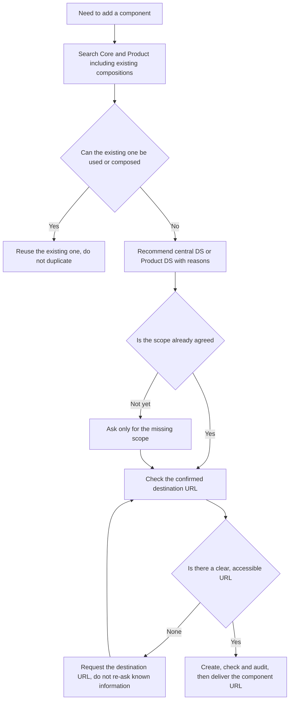
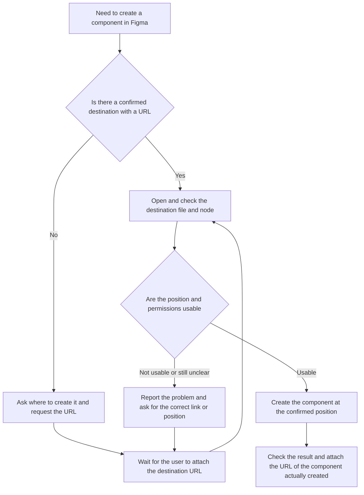
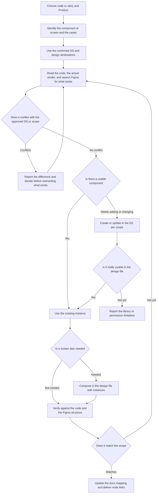

# Flow: Code → Design in Figma

Used as a branch of the [UI workflow](ui-workflow.md) for taking a component or screen from code to Figma. It is not the start of a migration or a whole-system sync; it uses the central rules and the existing docs/tests/audit steps

## Example command

> Take this component and screen from code to Figma for Product A, using DS file [link] and design file [link]; update what exists first, do not delete old items, then verify against the code (Thai: "นำ component และหน้าจอนี้จากโค้ดไป Figma ของ Product A ใช้ไฟล์ DS [ลิงก์] กับไฟล์ design [ลิงก์] อัปเดตของเดิมก่อน ไม่ลบของเก่า แล้วตรวจเทียบกับโค้ด")

You can specify “DS components only” (Thai: “เฉพาะ component ใน DS”) or “screens in the design file only” (Thai: “เฉพาะหน้าจอใน design file”). There is no need to write to both files every round. Use the destination confirmed in earlier work, do not ask again if it is clear, and do not guess the design file from the DS file

## Order of work

### Before adding a component: check what exists and choose the DS

1. Search for existing components and compositions in the central DS and the Product DS first, covering both the code-side mapping and the relevant Figma. If it can be reused or composed, use what exists and do not start building a duplicate set
2. If one really must be added, the AI recommends a scope with reasons: **central DS/Core** for parts shared without tying to a specific domain, or **Product DS** for Product-specific data/behavior; do not decide from similar appearance alone
3. Use the scope and URL already agreed for that task/Product without asking again. If it is still unclear, ask only for what is missing, and request the URL of the destination page/frame/section before writing; do not assume the central DS file is the Product DS file
4. Example question: “This one has lab-specific data, so I recommend placing it in DS Product A. Do you want to use this scope, and where in Figma should it be created? Feel free to attach the destination URL.” If the scope or URL is already known, remove the known parts from the question
5. Create only once the destination is confirmed and accessible, then check/audit and deliver the URL of the actual component per the existing steps. Adding in code-only follows the same Core/Product judgment, but does not require asking for a Figma URL when Figma output was not requested

The URL part of the diagram applies to Figma work; code-only work checks the source path per Product instead. Mermaid source status: not yet rendered in the real destination

### Mandatory checkpoints on both sides

- **Before taking code to Figma:** test and do the Component Audit on the code side per the UI workflow, including docs/Storybook and the affected consumers. Let the user try it and approve it first; when the user orders it to be taken to Figma, start writing to that destination. If there is recent verification evidence that matches the same source, it can be reused; do not re-run without a change
- **After composing in Figma:** check component/instance linkage, variable bindings, naming, variants/states, auto-layout/constraints, and compare the render against the prototype web in desktop/tablet and mobile frames per scope. Use the audit skill for bindings/naming and the matching Figma skill to read/render/compare. The React Component Audit is not counted as having checked Figma
- When differences are found, fix them within scope and re-check before delivering node links with the results Pass / Needs fix / Could not check; state the outstanding limitations; never report full parity from checking only the code side

1. Identify the workspace/Product, the source component/story/screen and the cases to bring over. Check whether the code is an approved version or a draft; do not promote an experiment into the library on your own
2. Identify the output: editable Figma Design layers/components or runnable code, which are different results. If the user wants a component library, use real components/instances; do not substitute a screenshot or Code Layer and claim a component in Design can be edited
3. Check the source, props/variants, tokens, stories and the actual rendered UI within scope; do not infer behavior or API from a screenshot alone. Follow the Stories skill when opening/checking stories
4. Before creating a component, identify the user-confirmed destination with a real URL. If there is none, ask **“Where in Figma would you like this component to be created? Please attach the URL of the destination page/frame/section”**. Use a URL with a node-id when the user wants a specific position; if there is only a file URL and the position is not yet chosen, ask only for the missing page/frame/section; do not guess a node or start creating in the current selection on your own. An existing confirmed mapping/context with a URL can be used without asking again, but if several destinations conflict, ask before writing. Screen-only work does not allow automatic library edits
5. Read the Figma skill that matches the result before using tools: library for creating/editing components, generate-design for composed screens and use for the Plugin API; code-workflows when importing code within the skill's scope. If a new file is requested, read create-new-file before creating
6. Search Figma's existing components/variables/styles and the mapping to code first. Check main components, variants and instance overrides; do not create a duplicate set from a slightly different name
7. Compare code against the approved Figma DS. If they conflict, separate what was requested to change from the existing drift. A code → design order does not permit hardcodes or code bugs to silently overwrite approved tokens
8. If a component exists and is sufficient, reuse the instance. If a component must be adjusted within scope, update the existing main component/variants. If it does not exist yet and the task allows it, create the reusable parts before composing; do not delete the existing library or add props the user has prohibited
9. Use variables/styles and approved geometry/state recipes; check auto-layout, sizing, constraints and resizing. Preserve the purple dashed outline of the component set per the central rules
10. When there is another design file, check whether the library/components are really usable across files. If the library must be published, there are permission limits, or the import tool cannot do it, report it and request the necessary action; do not publish on your own or claim a local copy is a linked library
11. Compose screens with reusable instances and compositions; separate the cases in scope and name them clearly; do not automatically expand every flow/state. If a multi-state flow is wanted, use prototype-to-figma within the agreed scope
12. Check the render and structure against code/story for the selected cases, including Thai text, dimensions, typography, icons, tokens, layout and responsive constraints. A frame being resizable does not prove responsiveness at every breakpoint
13. Update the docs/mapping that were actually affected; deliver node links, the list of what was reused/created/changed, and the outstanding differences. Keep visual parity, variable binding, component linkage and prototype behavior separate; do not call it all a complete sync

## Overview

### Destination question before creating a component

Applies to every component-creation task in Figma, including work that starts from a description, not only Code → Design. The answer must be obtained and the URL checked before the step that writes to that destination. While waiting, code can still be read and the anatomy/variants laid out. When delivering, attach the URL of the component/component set actually created; do not use the original destination URL in place of evidence that the new component exists

Audience: the DS team and both AIs / Question: how does code become a reusable Design in Figma / Read top to bottom; conditions are on the arrows; the table and steps are the text fallback

## Scope and limitations

Latest agreement 25 November 2026: screens/cases agreed to be taken to Figma use **2 representative sizes**, namely **1 desktop/tablet size + 1 mobile size**; desktop and tablet are not split into three sizes. This does not mean making two frames for the whole project, and does not permit expanding every state automatically. Use the widths confirmed in the Product/reference first; if there are none, propose and confirm; do not treat the user as having chosen a px value. The prototype web must also be checked for real responsiveness between sizes. If tablet is found to need a different layout, report it before adding a size in Figma

| Situation | What to do |
|---|---|
| DS and design are in different files | Keep the mapping per Product separately for the two destinations; use what exists without asking again within the task |
| Only screens requested but the DS lacks a part | Report the gap; request additional scope only when the library must be changed |
| Something already exists in Figma | reuse/update first; do not delete to start over without asking |
| Can copy across files but cannot link the library | Say it is a local copy or a limitation; do not claim a linked instance |
| The prototype has behavior that Design cannot show | Show the agreed state/annotation; do not claim the prototype works like the code |
| No Code Connect | Use the mapping evidence that exists; do not force installation or claim automatic sync |
| Tools/permissions insufficient | Continue the independent parts, report pending; do not change method to avoid the limitation |

This is an agent workflow, not a background sync. Do not write back to code from Figma in this round on your own unless the user asks. The approved DS and the latest constraints still take precedence over copying an implementation without checking

Written per the mermaid-diagrams skill / 25 November 2026 / Sources: project rules and flows agreed in chat / Diagram destination: Markdown that supports Mermaid / Status: structure checked by reading, parser/render not yet checked in the real destination; no Figma was written from this documentation work
