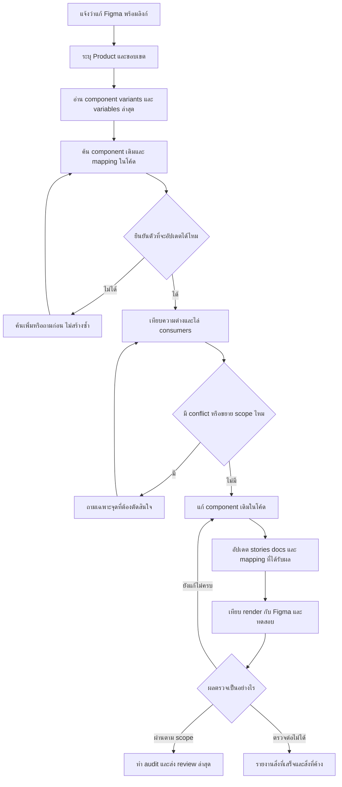

# Flow: ปรับ component ใน Figma แล้วอัปเดตโค้ด

ใช้ร่วมกันสำหรับ Codex และ Claude ผ่านกฎกลาง อ่านร่วมกับ [UI workflow](ui-workflow.md) ส่วนนี้ระบุขั้นเฉพาะของ Figma → Code; การ reuse, docs, testing และ audit ใช้ขั้นเดิม ไม่สร้างกฎอีกชุด

## เริ่มด้วยคำสั่งแบบไหน

> ฉันปรับ Button ใน Figma แล้ว ช่วยอัปเดตโค้ดตาม node นี้ [ลิงก์] ใช้ component เดิม ตรวจทุก variant ที่เปลี่ยน แล้วอัปเดต Storybook กับ doc พร้อม audit ด้วย

- งานเฉพาะ Product: เพิ่ม “เฉพาะ Product A ยังไม่แก้ Core”
- งานกลาง: เพิ่ม “ปรับ Core และตรวจผลกระทบทุก Product ที่ใช้”
- ถ้าแชตระบุ Product ไว้แล้ว ใช้บริบทเดิม ไม่ถามซ้ำ เว้นแต่ node/ไฟล์ขัดกับปลายทางนั้น
- ถ้าขอ sync โดยไม่ระบุทิศทาง กฎกลางมีค่าเริ่มต้น code → Figma แต่คำสั่งว่า “แก้โค้ดตาม Figma” ระบุ Figma → Code ชัดเจนและมีผลเหนือค่าเริ่มต้น

## ลำดับงาน

1. ยืนยัน workspace, Product/mode, node และขอบเขตจากคำขอ ตรวจว่าเป็น main component, component set หรือ instance บนหน้าจอ ก่อนตีความว่าเปลี่ยน Core
2. อ่านสกิล Stories ก่อนแก้ UI และอ่านสกิล Figma design-to-code ก่อนใช้ get_design_context หากต้อง inspect ผ่าน JavaScript ใน Figma ให้อ่าน figma-use ก่อนใช้เครื่องมือ ตามข้อกำหนดของ plugin ที่ติดตั้งจริง
3. อ่าน Figma ล่าสุด: anatomy, variants, states, properties, variable bindings, typography, auto-layout, sizing และ constraints ที่เกี่ยวข้อง ไม่ดูเฉพาะภาพ default หรือข้อมูลจากแชตเก่า
4. ค้น component เดิมและ mapping ในโค้ด ตรวจชื่อ หน้าที่ props และ consumers ถ้าไม่มี mapping ให้ค้นจากหลักฐานจริงก่อน หากยังระบุไม่ได้ให้ถาม ไม่สร้าง component ซ้ำขึ้นมาแก้ปัญหา
5. เทียบความต่างเป็นรายการ: Figma ปัจจุบัน / โค้ดปัจจุบัน / สิ่งที่จะอัปเดต / ผลกระทบหรือข้อขัดแย้ง แยก approved visual spec ออกจากพฤติกรรมที่ implement จริง
6. ถ้าเป็นการเปลี่ยน variable ให้ทำ [variable-change flow](figma-variable-change-flow.md) รวมการอ่านและเทียบ snapshot ทั้งชุด ไม่อ่านเฉพาะสีบน node แล้วอ้างว่า sync variables ครบ
7. ตรวจ consumers และขอบเขตตาม UI workflow ใช้ props/tokens เดิม หากต้องเพิ่ม API, เปลี่ยน behavior นอกงาน หรือขัดข้อจำกัดผู้ใช้ ให้ถามเฉพาะส่วนนั้นและทำส่วนอิสระต่อได้
8. แก้ component เดิมที่ระดับต้นเหตุ คง business behavior ที่ไม่ได้สั่งเปลี่ยน ไม่ใช้ภาพ prototype เป็นหลักฐานให้เดา validation, permission หรือ backend outcome
9. อัปเดต stories, component docs และ mapping ที่ได้รับผลจริง **และเชื่อม/อัปเดต Code Connect (`shadcn/code-connect/*.figma.tsx`) ของ component ใหม่หรือชุดที่เปลี่ยนชื่อทุกครั้ง** ดูกฎใน [workflow-map.md](workflow-map.md) · ถ้าไม่มี Code Connect ให้ใช้ mapping หลักฐานที่มี ไม่บังคับติดตั้ง/ตั้งค่า Code Connect เพื่อเริ่มงาน
10. เทียบ render กับ Figma สำหรับ variants/states ที่เปลี่ยน รวม mobile/resizing, ภาษาไทยยาว, keyboard/focus และ page/portal ตามผลกระทบ ทำ tests และ Component Audit ตาม UI workflow ไม่รันซ้ำเพียงเพราะเอกสารหลายตัวเรียกขั้นเดียวกัน
11. ส่ง review รอบล่าสุดพร้อมสิ่งที่ตรงแล้ว, สิ่งที่ยังต่าง, สิ่งที่ตรวจไม่ได้ และ consumer ที่ตรวจจริง ไม่เรียก component-audit ว่าเป็นหลักฐาน parity หากไม่ได้เทียบ Figma

## จุดตัดสินใจที่ต้องระวัง

| เปลี่ยนใน Figma | การดำเนินการ |
|---|---|
| Main component / component set | เทียบ component กลางและ consumers ไม่ถือว่า instance overrides ทุกตัวเปลี่ยนตามโดยไม่มีการตรวจ |
| Instance บนหน้าจอ | ตรวจว่าเป็น override เฉพาะหน้าหรือข้อเสนอ Core ห้าม promote override เข้า Core เอง |
| Variable / alias / mode | เข้า variable-change flow และ trace consumers |
| Variant / property ใหม่ | ตรวจการประกอบด้วย API เดิมก่อน หากต้องเพิ่ม prop ให้แจ้งก่อนตามข้อจำกัดของเรา |
| Interaction / prototype | ยืนยัน observable behavior และ business rule แยกจาก visual state |
| Figma ขัด DESIGN.md หรือข้อห้ามล่าสุด | แจ้ง conflict ไม่เลือกทับกฎอื่นเงียบ ๆ |
| เข้าถึง Figma หรือ consumer บาง Product ไม่ได้ | ระบุข้อจำกัด ตรวจส่วนที่ทำได้ ไม่อ้างว่าอ่านหรือ sync ครบ |

## ภาพรวม

ผู้อ่านคือ designer, developer และ AI ทั้งสอง เป้าหมายคือรู้ขั้นตอนอัปเดตโค้ดหลังแก้ Figma อ่านจากบนลงล่าง กล่องเป็นการทำงาน ข้าวหลามตัดเป็นจุดตัดสินใจ ลูกศรมีชื่อเงื่อนไข ไม่ใช้สีแทนความหมาย

## ขอบเขตการ sync

รอบนี้ Figma เป็นแหล่ง visual ที่ขอให้โค้ดตาม ไม่เอาโค้ดเก่าเขียนกลับไปทับดีไซน์ใหม่ การอ่าน Figma ไม่อนุญาตให้เขียนกลับเอง Code Connect ช่วยระบุ mapping ไม่ใช่ระบบ sync อัตโนมัติ การเปลี่ยน doc หรือโค้ดไม่พิสูจน์ว่ามีการแก้ Figma แล้ว

สถานะ: เอกสาร workflow และ Mermaid source เขียนตามสกิล mermaid-diagrams วันที่ 25 พฤศจิกายน 2026 แหล่งข้อมูลคือคำตัดสินในแชตและกฎปัจจุบันของ workspace มีข้อความ/ตารางสำรองสำหรับการอ่านโดยไม่มี renderer ยังไม่ได้ตรวจ parser หรือ render ในปลายทางจริง ไม่ใช่การเริ่ม sync component ใดในรอบนี้
