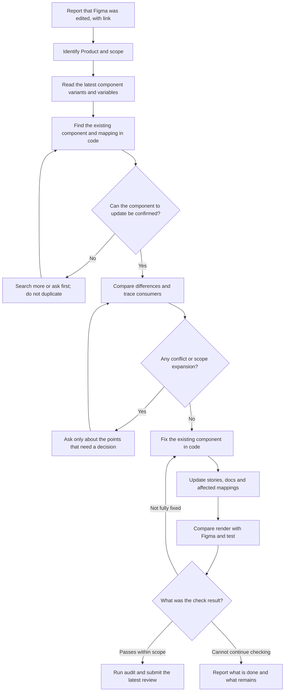

# Flow: adjust a component in Figma, then update the code

Shared by Codex and Claude via the central rules. Read together with [UI workflow](ui-workflow.md); this section states the steps specific to Figma → Code; reuse, docs, testing and audit use the existing steps and no second rule set is created

## What command to start with

> I adjusted Button in Figma; please update the code to match this node [link]. Use the existing component, check every changed variant, then update Storybook and the doc along with an audit (Thai: "ฉันปรับ Button ใน Figma แล้ว ช่วยอัปเดตโค้ดตาม node นี้ [ลิงก์] ใช้ component เดิม ตรวจทุก variant ที่เปลี่ยน แล้วอัปเดต Storybook กับ doc พร้อม audit ด้วย")

- Product-specific work: add "Product A only, do not change Core yet" (Thai: "เฉพาะ Product A ยังไม่แก้ Core")
- Shared work: add "adjust Core and check the impact on every Product that uses it" (Thai: "ปรับ Core และตรวจผลกระทบทุก Product ที่ใช้")
- If the chat has already specified a Product, use the existing context and do not ask again, unless the node/file conflicts with that destination
- If sync is requested without a direction, the shared rule defaults to code → Figma, but the instruction "fix the code to match Figma" (Thai: "แก้โค้ดตาม Figma") clearly states Figma → Code and overrides the default

## Order of work

1. Confirm the workspace, Product/mode, node and scope from the request; check whether it is a main component, a component set or an instance on a screen, before interpreting it as a Core change
2. Read the Stories skill before changing UI and the Figma design-to-code skill before using get_design_context; if you must inspect via JavaScript in Figma, read figma-use before using the tool, as required by the actually installed plugin
3. Read the latest Figma: anatomy, variants, states, properties, variable bindings, typography, auto-layout, sizing and relevant constraints; do not look only at the default image or data from an old chat
4. Search for the existing component and mapping in code; check its name, role, props and consumers. If there is no mapping, search from actual evidence first; if it still cannot be identified, ask; do not create a duplicate component to solve the problem
5. Compare the differences as a list: current Figma / current Code / what will be updated / Impact or conflict; separate the approved visual spec from the behavior actually implemented
6. If it is a variable change, run the [variable-change flow](figma-variable-change-flow.md), including reading and comparing the whole snapshot; do not read only the colors on a node and claim the variables are fully synced
7. Check consumers and scope per the UI workflow; use existing props/tokens. If an API must be added, behavior outside the task changed, or a user constraint violated, ask only about that part and continue with the independent parts
8. Fix the existing component at the root cause level; keep business behavior that was not ordered changed; do not use a prototype image as evidence to guess validation, permission or backend outcomes
9. Update stories, component docs and mappings that are actually affected **and link/update Code Connect (`shadcn/code-connect/*.figma.tsx`) for every new or renamed component or set**; see the rule in [workflow-map.md](workflow-map.md) · if there is no Code Connect, use the mapping evidence available; do not require installing/setting up Code Connect to start work
10. Compare the render with Figma for the changed variants/states, including mobile/resizing, long Thai text, keyboard/focus and page/portal according to the impact; run tests and the Component Audit per the UI workflow; do not rerun merely because several documents call the same step
11. Submit the latest review round with what matches, what still differs, what could not be checked and the consumers actually checked; do not call component-audit evidence of parity if Figma was not compared

## Decision points to watch

| Changed in Figma | Action |
|---|---|
| Main component / component set | Compare the central component and consumers; do not assume every instance override changes accordingly without checking |
| Instance on a screen | Check whether it is a page-specific override or a Core proposal; do not promote an override into Core on your own |
| Variable / alias / mode | Enter the variable-change flow and trace consumers |
| New variant / property | Check composition with the existing API first; if a prop must be added, notify first per our constraints |
| Interaction / prototype | Confirm observable behavior and business rules separately from visual state |
| Figma conflicts with DESIGN.md or the latest prohibition | Report the conflict; do not silently override another rule |
| Some Product's Figma or consumer is not accessible | State the limitation and check what can be done; do not claim to have read or synced everything |

## Overview

The readers are designers, developers and AI alike. The goal is to know the steps for updating code after editing Figma. Read from top to bottom; boxes are work, diamonds are decision points, arrows carry condition names, and color is not used in place of meaning

## Sync scope

This round Figma is the visual source that the code is asked to follow; old code is not written back over the new design. Reading Figma does not permit writing back on its own. Code Connect helps identify mappings and is not an automatic sync system. Changing a doc or code does not prove that Figma has been edited

Status: the workflow doc and Mermaid source were written per the mermaid-diagrams skill on 25 November 2026. The sources are decisions in chat and the workspace's current rules. There is fallback text/table for reading without a renderer. The parser or render in the real destination has not yet been checked. This is not the start of syncing any component in this round
