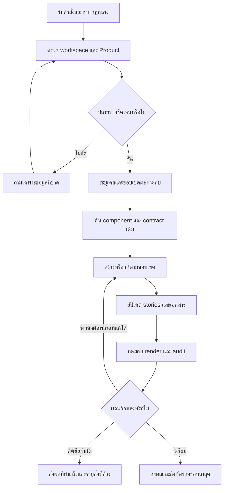
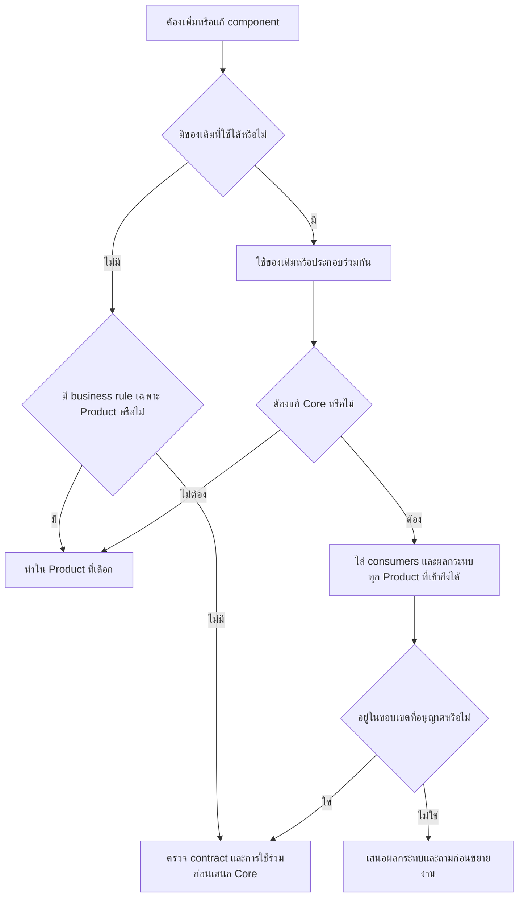
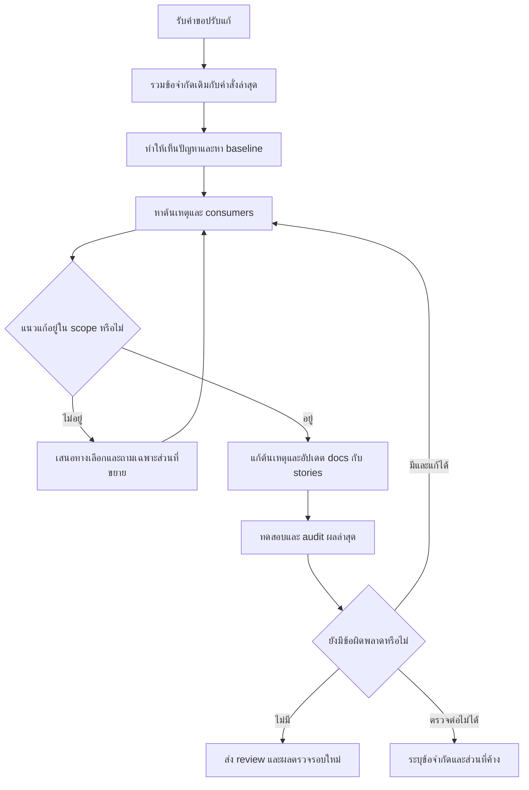

# Workflow สร้างและแก้ UI

ใช้ร่วมกันสำหรับ Codex และ Claude Code ใน workspace นี้ อัปเดต 25 พฤศจิกายน 2026

## เมื่อไหร่ต้องใช้

รวม flow และตำแหน่งเอกสารที่ [Workflow index](../docs/UI-WORKFLOW-INDEX.md) สำหรับกรณีแก้ component ใน Figma แล้วอัปเดตโค้ดตาม ใช้ [Figma component → Code](figma-component-to-code-flow.md) ร่วมกับขั้นตอนหลักด้านล่าง

ใช้เมื่อสร้างหน้าจอ/component, ประกอบหน้าจอจาก DS, แก้ดีไซน์หรือบั๊ก UI, เปลี่ยน styles/tokens หรือ refactor โค้ด UI แม้ตั้งใจคงหน้าตาเดิม ไม่ใช้กับงานเอกสารอย่างเดียวหรือ backend ที่ไม่กระทบ UI

อ่าน `rules/agent-rules.md` เป็นกฎโครงการ, `DESIGN.md` เป็นแนวทางหน้าตา และ `rules/core-rules.md` เป็นกฎ implementation ไม่คัดลอกค่าดีไซน์มาสร้างชุดใหม่ใน workflow นี้

## 1. เข้าใจงานและตรวจสภาพปัจจุบัน

- ระบุ Product/mode, หน้าหรือ component, ผลลัพธ์ที่ขอ (code, Figma หรือทั้งคู่) และข้อจำกัดจากคำสั่งล่าสุด ใช้สิ่งที่ทราบในแชตและ source ก่อน ถามเมื่อข้อมูลที่ขาดทำให้ตัดสินใจต่อไม่ได้จริง
- อ่านไฟล์เป้าหมาย, imports, stories และ docs ที่เกี่ยวข้อง ตรวจ working changes ก่อนเขียน และรักษางานของอีกคน/อีก AI ไม่ไล่ refactor ของนอกขอบเขต
- บอกทิศทางสั้น ๆ และสิ่งที่จะทำ งาน UI ที่อนุญาตแล้วให้เดินหน้าตามขอบเขตได้ ไม่เพิ่มจุดขออนุมัติทุกขั้น
- ตรวจสกิลและเครื่องมือที่มีจริงตามตารางท้ายไฟล์ **อ่านสกิล Stories เป็นตัวแรกก่อนแก้ UI** ถ้ามีอยู่ใน session/เครื่องนั้น ทำตาม CLI help ของเวอร์ชันที่ติดตั้ง ห้ามเดา payload, props หรือ story IDs

## 2. วางเคสตามขนาดของงาน

- งานหน้าจอ/flow ใหม่ใช้ `case-planning` ดู happy path และเฉพาะ loading, empty, error/retry, validation, disabled, success, permissions และข้อมูลยาว/ขาดที่เกี่ยวข้อง งานแก้จุดเล็กตรวจเคสที่พังและ consumer ใกล้เคียง ไม่ต้องขยายเป็น flow ใหม่
- แยก **ยืนยันแล้ว / เสนอเพิ่ม / ต้องถาม** จากหลักฐาน requirement และพฤติกรรมเดิม ไม่สร้าง business rule, สิทธิ์ผู้ใช้ หรือ backend outcome เอง
- กำหนด expected result ที่สังเกตได้และทางเปิดดูแต่ละเคสผ่าน stories/preview ใช้ IDs เดิมเมื่อมี ไม่อ้างว่ามี board รวมทุกเคสถ้ายังไม่ได้สร้าง
- ถ้าต้องถาม business rule ให้ทำส่วนที่ไม่ขึ้นกับคำตอบต่อได้ แต่ไม่เดาคำตอบหรือถือว่าเงียบเท่ากับอนุมัติ

## 3. หาของเดิมก่อนสร้าง

- ใช้ `component-reuse-check` ค้น Core → Product ปัจจุบัน → ของ Product อื่นที่เข้าถึงได้ตาม ownership รวมส่วนประกอบย่อย เช่น sidebar, field, modal, pagination และ icons
- ใช้ Storybook documentation tools ดู props/ตัวอย่างจริงเมื่อมี และตาม imports ไปยัง implementation เพื่อยืนยันว่า reuse ของจริง ไม่ใช่ component หน้าตาเหมือน
- เลือก existing component → composition → extension ที่จำเป็น → component ใหม่พร้อมเหตุผล ใช้ลำดับแหล่งอ้างอิงและกฎรับ component ภายนอกจาก `rules/agent-rules.md` และ `rules/component-adoption-flow.md`

## 4. ออกแบบและเขียนโค้ด

- อ่าน `skills/unslop/SKILL.md` อัตโนมัติเพื่อจัด hierarchy, spacing และความเรียบร้อย ใช้ทิศทางจาก Product และ DS ที่มี ไม่ให้ generic recipe ทับกฎกลาง หากเป็นการแก้เฉพาะจุดให้ปรับเฉพาะส่วนนั้น
- งาน shadcn ใช้สกิล `shadcn` และ contract จริงของ Base UI ยึดตำแหน่ง Core/composed/Product และการแยก hook/model/fixtures ตามกฎโครงการและโครงสร้างที่ใช้งานอยู่
- ใช้ props, tokens, fonts, geometry และ spacing scale ที่อนุมัติแล้ว ไม่เปลี่ยน Core กว้างขึ้นเพียงเพื่อแก้หน้าเดียว ถ้าจำเป็นต้องเปลี่ยน shared component ให้ไล่ consumer และแจ้งผลกระทบข้าม Product
- คง behavior/content เมื่อเป็นงานแก้หน้าตาหรือ refactor ไม่เริ่ม UX writing, ย้าย stack, เพิ่ม dependencies หรือเปลี่ยน API จากคำแนะนำของ reference โดยอัตโนมัติ
- ถ้าแก้ Figma variables ให้ทำ `rules/figma-variable-change-flow.md` สำหรับการอ่าน/เทียบ/อัปเดต แล้วใช้ขั้นตรวจและรายงานของ workflow นี้ต่อโดยไม่รัน audit ซ้ำชุดเดิม
- Figma output ใช้เฉพาะปลายทางและทิศทางที่อยู่ในงาน ค่าเริ่มต้นเมื่อขอ sync คือ code → Figma แต่การแก้ UI code ไม่ได้สั่งให้เขียน Figma ทุกครั้ง งาน Figma-first ไม่บังคับเขียน code โดยไม่ขอ ตรวจสกิล Figma ที่เกี่ยวข้องก่อนใช้เครื่องมือ

## 5. อัปเดต stories และเอกสาร

- หลังแก้ component ตรวจ docs ที่เกี่ยวข้องทุกครั้ง ใช้ `document` อัปเดต contract/ตัวอย่าง/ข้อจำกัดที่เปลี่ยน ไม่สร้าง Markdown ใหม่ทุก component หากมีปลายทางที่เหมาะอยู่แล้ว
- เพิ่มหรือปรับ colocated stories ของ component ที่เปลี่ยนให้เปิดดูได้ พร้อม interaction สำหรับ behavior สำคัญ ใช้ case coverage จากขั้น 2 และรักษา story IDs เดิม
- ถ้าเพิ่ม/ลบ Core ให้ปรับรายการ coverage และตรวจ `npm run storybook:coverage` ตรวจว่า stories ลงทะเบียนใน Storybook จริง ไม่ถือว่าแค่มีไฟล์เท่ากับเปิดได้
- เอกสารต้องแยกสิ่งที่ implement แล้วกับ proposal/mock/Figma-only และ gap ที่ยังไม่ตรง ไม่รายงานว่าทุก case หรือทุก surface sync แล้วโดยไม่มีหลักฐาน

## 6. ตรวจผลจริงและแก้สิ่งที่พบ

- ตรวจ reuse หลังเขียนว่ามี component ซ้ำหรือ hand-built equivalent หลุดมาหรือไม่ จากนั้นทำ `component-audit` กับผลสุดท้ายและ consumer ที่ได้รับผล รวมหน้าและ portal เช่น modal/popover เมื่อเกี่ยวข้อง
- ตรวจ render ตามขอบเขต: desktop/mobile, ภาษาไทยยาว, wrapping/overflow, missing data, keyboard/focus, icon/text alignment และ state transitions เปรียบเทียบ role/variant/size เดียวกัน ไม่บังคับทุกขนาดให้หน้าตาเท่ากัน
- งาน UI code ใช้ checks ที่กฎกลางกำหนด: build, token check, Storybook build และ interaction tests ผ่าน Storybook `test-run` ที่ติดตั้ง เพิ่ม coverage check เมื่อ Core เปลี่ยน อย่ารัน checks เดิมซ้ำเมื่อไม่มีไฟล์เปลี่ยนหรือข้อสงสัยใหม่ งาน Figma-only ใช้การตรวจ node/variables/render ที่เกี่ยวข้องและบอกว่าไม่ได้ตรวจ code
- ทดสอบเคสเสี่ยงหรือบั๊กจริง ไม่เขียน test ที่ตรวจแค่ค่าคงที่หรือ import เดียวกัน หากไม่ผ่านให้แก้และทดสอบซ้ำในขอบเขตที่อนุญาต ห้ามปิด test/a11y หรือลดเกณฑ์เพื่อให้ผ่าน
- ปัญหา contrast/token ที่ต้องตัดสินใจต้นทางให้รายงาน ไม่ override สีเฉพาะหน้าเพื่อให้ผ่าน และไม่เรียก interaction tests ผ่านว่า accessibility ผ่านทั้งหมด
- ใช้ผลตรวจเดียวกันร่วมกันได้ ไม่รัน audit ซ้ำเพียงเพราะสกิลอีกตัวอ้างถึง ให้แยกงานค้นหาของซ้ำ, QA ของ code และ parity กับ Figma ชัดเจน

## 7. ส่งงานพร้อมหลักฐาน

- บอกสั้น ๆ ว่าเปลี่ยนอะไร, ใช้ component เดิมตัวไหน, อัปเดต doc/story ใด, ตรวจอะไรผ่าน/ไม่ผ่าน/ตรวจไม่ได้ และอะไรค้าง
- รายงานของ skills ใช้ format ที่ `.agents/skills/component-audit/references/report-format.md` อ้างไฟล์หรือผลจริง ไม่แต่งคะแนนหรือผลตรวจ
- เมื่อมี UI code เปลี่ยน ใช้ Stories workflow ค้น story IDs จากเครื่องมือและเผยแพร่ review ของรอบล่าสุด รวม stories ใหม่ทั้งหมด ส่งลิงก์ตามคำแนะนำเครื่องมือ ห้ามใช้ review เก่าหรือแต่ง URL
- ไม่อ้างว่าเสร็จสมบูรณ์หากยังมี test fail หรือส่วนสำคัญตรวจไม่ได้ รายงาน blocker พร้อมงานที่เสร็จแล้ว การส่ง preview ไม่ใช่การ publish
- การสร้าง UI ไม่อนุญาต push/deploy/publish, release numbering, ลบ legacy หรือกลับไปทำงานที่ผู้ใช้พับไว้ เว้นแต่ผู้ใช้ขอในงานนั้น กฎ workflow ไม่ข้าม permissions หรือการปฏิเสธของเครื่องมือ

## สกิลที่เรียกตามขั้น

| เรื่อง | สกิล/ตำแหน่ง | เรียกเมื่อ |
|---|---|---|
| Storybook docs, stories, tests และ review | `stories` จากสกิลที่ติดตั้งใน session | ก่อนแก้ UI เป็นตัวแรก และใช้ต่อในขั้นตรวจ |
| Case coverage | `.agents/skills/case-planning/SKILL.md` | วาง flow/เคสใหม่หรือ requirement เปลี่ยน |
| Flowchart/decision tree ของงาน | `skills/mermaid-diagrams/SKILL.md` | เมื่อขอแผนภาพ อ่านขอบเขตและข้อจำกัดจากกฎกลาง ไม่วาดทุกงานโดยอัตโนมัติ |
| Reuse และของซ้ำ | `.agents/skills/component-reuse-check/SKILL.md` | ก่อนเขียนและตรวจหลังเขียน |
| ความเรียบร้อยของ UI | `skills/unslop/SKILL.md` | สร้าง/ปรับ UI ตาม scope |
| React/shadcn | `.agents/skills/shadcn/SKILL.md` | implement code ที่ใช้ shadcn |
| เอกสาร component | `.agents/skills/document/SKILL.md` | ตรวจ/อัปเดตเอกสารที่ได้รับผล |
| QA code และ cross-surface | `.agents/skills/component-audit/SKILL.md` | ก่อนส่ง UI code ที่แก้ |
| Figma | สกิล Figma ตามงานที่ติดตั้งใน session | เมื่องานมี Figma output/read ที่ต้องใช้เครื่องมือ |

ตำแหน่ง `.agents/skills` ปัจจุบันเป็น symlink ไปชุดกลางของโปรเจกต์เก่า อย่าเขียนผ่าน symlink เพื่อแก้ workflow นี้ หากเครื่องของอีก AI ไม่มีสกิล ให้ค้นจากรายการติดตั้งและตำแหน่งจริงก่อน ไม่สมมติว่า slash command, MCP หรือ host path ของ Codex ใช้กับ Claude ได้ทั้งหมด

ถ้าไม่พบสกิลหรือเครื่องมือ ให้ระบุสิ่งที่ขาด ทำส่วนที่ทำได้ด้วยกฎกลางและคำสั่งที่มีจริง และระบุขั้นที่ตรวจไม่ได้ ห้ามอ้างว่าเรียกสกิล/ทดสอบ/sync สำเร็จ ไม่ติดตั้งสกิลหรือเปลี่ยน configuration ของอีก AI เงียบ ๆ

## ดูแลกฎต่อไป

แก้ข้อจำกัดโครงการที่ `rules/agent-rules.md`, ลำดับงานที่ไฟล์นี้, หน้าตาที่ `DESIGN.md` และรายละเอียด specialist flow ที่ไฟล์เจ้าของเรื่อง อัปเดตด้วยการอ้างอิงข้ามไฟล์ ไม่คัดลอกเป็นกฎอีกชุดใน AGENTS.md หรือ CLAUDE.md นี่เป็นคำสั่งให้ AI ทำตาม ไม่ใช่ background automation, hook หรือหลักฐานว่า AI ทั้งสองรันทดสอบ workflow นี้แล้ว

## คู่มือปฏิบัติ: เลือกงานและโปรเจกต์

ส่วนนี้ขยายขั้น 1–7 ด้านบน ไม่ใช่ workflow อีกชุด ผู้อ่านคือ designer, developer, Codex และ Claude เพื่อให้รู้ว่างานถัดไปต้องทำอะไร อ่าน flowchart จากบนลงล่าง กล่องคือการทำงาน ข้าวหลามตัดคือคำถามที่ต้องแยกทาง ลูกศรมีข้อความระบุเงื่อนไข ไม่ใช้สีเป็นตัวบอกสถานะอย่างเดียว

### แยกคำว่าโปรเจกต์ให้ชัด

| คำ | ความหมาย | AI ต้องตรวจ |
|---|---|---|
| Workspace/repository | โฟลเดอร์โค้ดที่เปิดอยู่ | absolute path, package.json, entry rules และ Git ที่มีจริง |
| Product | ผลิตภัณฑ์ภายใน workspace เช่น A/B | feature path, theme/mode และเจ้าของงาน |
| Core | component/token ที่หลาย Product ใช้ร่วม | consumers และผลกระทบข้าม Product |
| Figma DS file | library ของ Product | file key/node และ mapping ที่มีจริง |
| Figma design file | หน้าจอที่ใช้ DS นั้น | file key/page/node ปลายทาง ไม่เดาจากไฟล์ DS |

Product ไม่เท่ากับ theme mode และชื่อที่อยู่ในโฟลเดอร์เก่าไม่ใช่หลักฐานว่าเป็น Product ปัจจุบัน ห้ามสมมติว่า A/B มีอยู่แล้วใน source

### ข้อมูลที่ต้องรู้ก่อนเริ่ม

AI สรุปภายในงานให้ได้ว่า workspace ไหน, Product ไหน, แก้หน้า/เคสอะไร, ส่งออกฝั่งไหน, ใช้ theme ใด, ห้ามเปลี่ยนอะไร และจะใช้หลักฐานใดตรวจงาน ไม่ต้องให้ผู้ใช้กรอกฟอร์มทุกครั้ง

1. ใช้คำสั่งล่าสุดก่อน จากนั้นใช้บริบทที่เลือกไว้ในแชต แล้วตรวจ source/config เพื่อยืนยัน
2. ถ้ามี Product เดียวที่สอดคล้องกับไฟล์เป้าหมาย ให้บอกสมมติฐานสั้น ๆ แล้วทำต่อ
3. ถ้ามีหลาย Product และระบุไม่ได้ว่าจะเขียนที่ไหน ให้ถามครั้งเดียวว่าเลือก Product ใด พร้อมทำการค้นหาแบบอ่านอย่างเดียวต่อได้
4. จำ Product ภายในงาน/แชตจนผู้ใช้สลับ ไม่ถามซ้ำทุกขั้น แต่ไม่อ้างว่า session ใหม่จะจำได้เอง
5. ถ้าระบุชื่อ Product แต่ path หรือ Figma mapping ขัดกัน ต้องแก้ความคลุมเครือก่อนเขียนปลายทางนั้น
6. การเปิด workspace ใหม่ต้องอ่านกฎของ workspace นั้นใหม่ ไม่ยก runtime, branch, tokens หรือข้อยกเว้นของ workspace นี้ไปใช้โดยอัตโนมัติ

ภาพรวมการรับงานและส่งงาน:



### หลาย Product ใน workspace เดียว

- ใช้โครงสร้างจริงจากกฎกลาง ไม่สร้างโฟลเดอร์ Core/Product ชุดใหม่เพียงเพื่อให้ตรงตัวอย่างในแผน
- ส่วนประกอบที่มี business logic, รูปแบบข้อมูล หรือข้อความเฉพาะ Product อยู่ใน feature นั้น ใช้ Core ผ่าน dependency ที่อนุญาต
- ส่วนกลางต้องเป็นกลางต่อ Product ไม่ import screen/API ของ A เข้า Core และไม่ import internals ของ B เข้า A เพียงเพราะหน้าตาเหมือน
- ถ้าเจอของคล้ายใน B ให้รายงาน candidate และตรวจ contract ก่อน เสนอการย้ายเป็น shared composition เฉพาะเมื่อมีเหตุผล ไม่ promote เองจากจำนวนครั้งที่เห็น
- งานเฉพาะ A เริ่มตรวจและแก้ A ถ้าต้นเหตุอยู่ Core ให้ทำ impact analysis ก่อน ไม่แอบแก้ B หรือเปลี่ยน theme ทุก Product
- หากต้องเปลี่ยน Core แบบ compatible เพื่อแก้บั๊กที่อยู่ในงาน ให้แจ้งผลกระทบและตรวจ consumer ที่ได้รับผล หากต้องเปลี่ยน public API หรือ behavior ของ Product อื่นซึ่งไม่ได้อนุญาต ให้เสนอทางเลือกและถามก่อนส่วนที่ขยาย scope
- ถ้าเข้าถึง B ไม่ได้ ให้บอกว่าตรวจได้เฉพาะ A/Core อย่าอ้างว่า B ไม่กระทบ

การเลือกขอบเขตของ component:



### หลาย repository หรือหลายแชต

1. ระบุชื่อ/path ของ repository ที่เป็นเจ้าของการเปลี่ยน ตรวจวิธีรับ DS ของโปรเจกต์ปลายทางจาก imports/package config จริง ไม่สมมติว่าทุกแอปรับการแก้ Core ทันที
2. การแก้ DS repo ไม่ใช่การอัปเดต application repo ให้บันทึกทั้งสองสถานะแยกกัน เช่น DS แก้แล้ว / A ทดลองแล้ว / B ยังไม่ได้ตรวจ
3. หากใช้ package ให้ตรวจเวอร์ชัน/lockfile จริง หากเป็น source import ให้ตรวจ path จริง ช่วง Draft ยังไม่สร้าง release number เอง
4. ข้ามแชตหรือเปลี่ยน AI ให้ส่ง handoff ที่ระบุ workspace, Product, task scope, ไฟล์ที่เปลี่ยน, ข้อจำกัด, ผลตรวจ และขั้นตอนค้าง ไม่ใช้คำว่า “ทำต่อจากเดิม” เป็นข้อมูลเพียงอย่างเดียว
5. อย่าใช้ไฟล์ selected-product กลางเพียงไฟล์เดียวให้ทุกคนเขียนทับ การเลือก Product ต้องเป็นบริบทของงานแต่ละคน
6. ถ้าทำงานพร้อมกัน ให้แบ่งพื้นที่ไฟล์/งานก่อน งาน shared Core ที่ชนกันต้องประสานเจ้าของ ไม่ให้ AI อีกตัวเขียนทับเพื่อให้ผ่าน test

## คู่มือปฏิบัติ: เมื่อมีคำขอปรับแก้

คำขอใหม่ระหว่างทำงานเป็นการปรับงานเดิม เว้นแต่ผู้ใช้ยกเลิกหรือเปลี่ยนเป้าหมายอย่างชัดเจน ไม่เริ่มใหม่ทั้งหมดและไม่ทิ้งข้อจำกัดก่อนหน้า

### แยกชนิดคำขอก่อนแก้

| คำขอ | ทำอะไรต่อ | สิ่งที่ต้องรักษา |
|---|---|---|
| “ตรงนี้ล้น/พัง/ไอคอนผิด” | reproduce ด้วยเคสจริง แล้ว trace ถึงต้นเหตุ | API, business behavior และจุดอื่นที่ไม่เกี่ยว |
| “ปรับดีไซน์หน้านี้” | ตรวจ Product recipe และใช้ Unslop เฉพาะ scope | tokens และ component contracts ตามกฎกลาง |
| “เปลี่ยน component กลาง” | ตรวจ variant/state/consumer และ cross-Product impact | compatibility หรือแจ้ง breaking change |
| “เปลี่ยนสี/ฟอนต์/variables ใน Figma แล้ว” | เข้า variable-change flow ที่มีอยู่ | snapshot เดิม, provenance และข้อจำกัดล่าสุด |
| “เพิ่มเคส” | เพิ่มใน case coverage และ state/fixture/story ที่เหมาะ | ไม่แต่ง business rule ให้ครบเอง |
| “refactor” | เปลี่ยนวิธีเขียนตามโครงสร้าง แล้วเทียบ behavior/render | หน้าตา, API และ transitions ที่ไม่ได้ขอเปลี่ยน |
| “ย้อนกลับ” | ระบุการแก้ที่ต้องถอยและทำ targeted revert | งานก่อนหน้าและงานของผู้อื่น |
| “ทำเหมือนตัวอย่าง” | แยก reference aesthetics ออกจาก contract | component และ theme ของเรา |
| “หยุด/พับไว้ก่อน” | หยุดงานนั้นและบันทึกสิ่งที่ค้าง | ห้าม publish หรือเริ่มต่อจากบริบทเก่า |

### ลำดับการแก้แต่ละรอบ

1. อ่านคำขอใหม่ร่วมกับข้อจำกัดเดิม เช่น ไม่เปลี่ยน border/radius/props อย่าให้ข้อแก้ล่าสุดลบข้อจำกัดอื่นโดยไม่มีคำสั่ง
2. ระบุ scope ที่เปลี่ยนจากรอบก่อน ใช้ภาพ/ไฟล์/node เป็นหลักฐาน หากภาพยังระบุตัวจริงไม่ได้ให้ค้น consumer ก่อนถาม
3. reproduce และแยกสาเหตุ: token/theme ผิด, primitive recipe ผิด, consumer override ผิด, layout ผิด, fixture ไม่ตรง หรือ state logic ผิด ไม่เดาสาเหตุจากรูปอย่างเดียว
4. เก็บ baseline ที่พอเทียบได้ เช่น story, ขนาด viewport, fixture, computed styles และผลทดสอบ ไม่จำเป็นต้องสำรองทั้งโปรเจกต์ทุกครั้ง
5. แก้ที่ระดับต้นเหตุที่เล็กที่สุด การแก้ระดับหน้าไม่ควรสร้าง recipe ซ้ำ การแก้ Core ต้องตรวจผลกระทบกว้างขึ้นตาม dependency จริง
6. เพิ่ม regression test เมื่อเป็นบั๊กที่มี behavior/geometry สำคัญและทดสอบได้จริง ไม่เขียน test เพียงเพื่อยืนยัน literal ที่เพิ่งแก้
7. อัปเดตเอกสารและ stories ตาม final behavior ลบคำอธิบายที่หมดอายุภายในขอบเขตงาน ไม่เขียนประวัติการลองทุกแบบลง usage docs
8. รัน focused tests และตรวจ surface ที่ได้รับผล จากนั้น required checks ตามขั้น 6 ถ้าแก้อีกหลังตรวจ ต้องทดสอบส่วนที่ได้รับผลใหม่
9. ส่ง review รอบใหม่ สรุป “สาเหตุ / แก้อะไร / ตรวจอะไร / ค้างอะไร” ไม่ส่งภาพหรือ review ก่อนแก้มาแทนของล่าสุด

วงรอบนี้ใช้กับคำขอแก้ระหว่างงานและหลังส่งงาน:



### แก้เฉพาะตัวอย่างกับแก้ทั้งระบบ

- “หน้านี้” หมายถึง target surface ไม่ได้อนุญาต redesign Core ทั้งหมด
- “ทุกปุ่ม” ต้องระบุขอบเขตจากบริบทว่า Product นี้หรือ Core ถ้าคำตอบต่างกันแล้วกระทบการเขียน ให้ถามก่อน
- “ให้เหมือนกัน” ให้เทียบ semantic role/variant/size เดียวกัน ไม่ปรับทุก variant ให้เหมือนกันจนสูญเสียสถานะ
- ถ้าแก้ใน Figma ให้ตรวจ component set, main component, instances และ overrides ที่เกี่ยวข้องตามสิทธิ์ ห้ามบอกว่าแก้ทุก instance จากการแก้ตัวอย่างเดียว
- ถ้าแก้เฉพาะ code อย่ารายงานว่า Figma อัปเดตแล้ว และกลับกัน หากไม่มี mapping ให้บอกว่าตรวจ parity ไม่ได้
- เมื่อ code กับ Figma ขัดกัน ต้องแยก implemented behavior กับ approved visual spec ไม่เลือกฝั่งชนะทุกเรื่องแบบตายตัว

### ย้อนกลับและทดลองแบบไม่รับเข้า Core

การขอ “ลอง” อนุญาต prototype ตาม scope แต่ไม่ใช่การ adopt เข้า Core หรือเผยแพร่ ใช้พื้นที่ทดลองที่มีอยู่และบอกว่าเป็น draft หากยังไม่มี sandbox ให้แยกไฟล์ Product/experiment อย่างชัดเจน ไม่อ้างว่ามีระบบ save slots/playground อัตโนมัติแล้ว

เมื่อผู้ใช้ไม่เอา ให้ถอยเฉพาะ diff ของการทดลอง ตรวจ working changes ล่าสุดก่อน ห้าม reset ทั้ง repo หรือคืนไฟล์ทับงานอีก AI หลังถอยต้องตรวจว่า imports/stories/docs ไม่อ้างสิ่งที่ถอดออก หากระบุจุดย้อนกลับไม่ได้ให้ถาม ไม่เดา slot/commit

## ตัวอย่างวิธีสั่งงาน

ผู้ใช้ไม่ต้องระบุรายชื่อสกิลหรือคำสั่งทดสอบ AI ต้อง route ให้เอง ตัวอย่างต่อไปนี้เป็นแม่แบบ ไม่ใช่ Product ที่สร้างไว้แล้ว:

| กรณี | ตัวอย่างคำสั่ง |
|---|---|
| เริ่ม Product | “รอบนี้ทำ Product A ในโฟลเดอร์ … ใช้ theme … ทำหน้ารายการนัดหมายในโค้ด” |
| ทำต่อใน Product เดิม | “เพิ่มเคส empty กับโหลดไม่สำเร็จในหน้านี้” |
| สลับ Product | “เปลี่ยนไป Product B ก่อน แก้หน้า dashboard ไม่แตะของ A” |
| หลาย repository | “แก้ Core ใน repo … แล้วลองนำไปใช้ใน A ที่ … ส่วน B ยังไม่ต้องแก้” |
| แก้เฉพาะจุด | “แก้ชื่อไทยยาวแล้วล้นบนมือถือ คงหน้าตาเดิมส่วนอื่น” |
| เปลี่ยน Core | “ปรับ Button กลาง แล้วตรวจทุก consumer ที่ได้รับผลทั้ง A และ B” |
| ปรับ Figma | “แก้เฉพาะ Figma ตาม node นี้ ใช้ DS เดิม ไม่เปลี่ยนโค้ด” |
| Sync สองฝั่ง | “sync component นี้จาก code ไปไฟล์ DS … และหน้าตัวอย่างใน design file …” |
| ลองดีไซน์ | “ทำแบบทดลองอีกแนว เทียบกับเดิม ยังไม่เอาเข้า Core” |
| หยุด/ย้อน | “หยุดเรื่องนี้ไว้ก่อน” หรือ “ถอยเฉพาะการปรับรอบล่าสุด เก็บการแก้ก่อนหน้าไว้” |
| ส่งต่อ AI | “อ่าน handoff งานนี้แล้วทำต่อเฉพาะขั้นที่ค้าง อย่าเริ่ม implementation ใหม่” |

## บันทึกส่งต่อและสถานะงาน

สำหรับงานใหญ่ หลาย Product หรือส่งต่อข้าม AI ให้เก็บบันทึกใน `docs/work-in-progress/<task-name>.md` เมื่อจำเป็น เป็น task-specific ไม่ใช่ไฟล์กฎกลาง และไม่ต้องสร้างสำหรับทุกคำถามสั้น ๆ ชื่อเป็นตัวอย่างของตำแหน่งที่จะสร้างเมื่อมีงาน ไม่ใช่ claim ว่ามีระบบ task tracking แล้ว

ข้อมูลขั้นต่ำของบันทึก:

```text
งาน / วันที่อัปเดต:
Workspace และ Product/mode:
เจ้าของงานและพื้นที่ไฟล์ที่รับผิดชอบ:
เป้าหมาย / สิ่งที่ไม่อยู่ใน scope:
ข้อจำกัดและคำตัดสินของผู้ใช้:
Code paths / Figma DS และ design destination:
เคสที่ยืนยัน / เสนอ / ยังต้องถาม:
ไฟล์และสิ่งที่เปลี่ยนแล้ว:
ผลตรวจล่าสุด พร้อมคำสั่ง/หลักฐานและเวลาที่ตรวจ:
ข้อผิดพลาดเดิม / ข้อผิดพลาดจากงานนี้:
สิ่งที่ค้าง / ขั้นถัดไป:
สถานะ: กำลังทำ / รอคำตอบ / พัก / พร้อมตรวจ / เสร็จตาม scope
```

อย่าใส่ secrets หรือ credentials ในบันทึก ก่อน AI ตัวถัดไปแก้ต้องอ่าน source จริงและตรวจว่าตรงกับ handoff หรือไม่ Handoff ไม่ใช่ lock และไม่ใช่สิทธิ์ขยายงาน ถ้ามีความต่างให้ reconcile ก่อน ไม่ใช้สถานะ “เสร็จ” แทนผลทดสอบ

## เมื่อใดต้องถาม และเมื่อใดทำต่อได้

| เหตุการณ์ | การดำเนินการ |
|---|---|
| รู้อยู่แล้วว่า Product/ปลายทางใด | ทำต่อ ไม่ถามซ้ำ |
| ปรับ implementation ปกติภายในงานที่อนุญาต | แจ้งทิศทางสั้น ๆ แล้วทำต่อ |
| มีค่าจาก DS และ contract ที่ชัด | ใช้ค่าที่มี ไม่ให้ผู้ใช้คิดตัวเลขใหม่ |
| ไม่รู้ว่าจะเขียน Product A หรือ B | ค้นบริบทก่อน ถ้ายังแยกไม่ได้ให้ถาม |
| ต้องตัดสิน business rule หรือเปลี่ยนสิทธิ์ | ถามและรอส่วนที่ขึ้นกับคำตอบ |
| ต้องขยาย API/เปลี่ยน behavior ของ Product อื่น | เสนอผลกระทบและขอขอบเขตก่อน |
| เข้าถึง Figma/skill/consumer ไม่ได้ | ทำส่วนอิสระต่อและระบุสิ่งที่ตรวจไม่ได้ |
| เครื่องมือปฏิเสธ action | รักษาเหตุผลการปฏิเสธ ไม่เปลี่ยนวิธีเพื่อเลี่ยง permissions |
| ต้อง publish แต่ผู้ใช้สั่งแค่ลอง UI | ไม่ publish |
| ผู้ใช้พักงาน | หยุดงานนั้น เก็บสถานะ ไม่ทำต่อเอง |

## หลักฐานก่อนถือว่าจบงาน

งานสร้าง/แก้ UI ต้องระบุ target ที่ส่งจริง, coverage ที่ตกลง, reuse ที่ตรวจ, docs/stories ที่อัปเดต และผลตรวจสุดท้าย ถ้าเหลือข้อจำกัดให้ตั้งสถานะตามจริง การที่หน้าหลักดูดีไม่พิสูจน์ว่า modal/mobile/ทุก Product ผ่าน ส่วน Figma-only ไม่ต้องอ้างว่า code build ผ่านจากรอบก่อน

งานนี้เป็นเอกสารคำสั่งและแผนภาพ ไม่ได้ติดตั้ง watcher, board, auto-sync, task lock หรือ orchestration ระหว่าง AI โดยอัตโนมัติ

### บันทึกการตรวจแผนภาพ

ผู้เขียน: Codex ตามสกิล mermaid-diagrams / วันที่: 25 พฤศจิกายน 2026 / ผู้อ่าน: ทีม DS และ AI ทั้งสอง / เป้าหมาย: Markdown ที่รองรับ Mermaid / รูปแบบ: flowchart TD แยกสามคำถาม / ข้อความสำรอง: ตารางและขั้นตอนในส่วนเดียวกัน / แหล่งข้อมูล: workflow และข้อกำหนดใน workspace นี้ / ความไม่แน่นอน: Product A/B และ path ตัวอย่างเป็นแม่แบบ ไม่ใช่ระบบที่ implement แล้ว / สถานะตรวจ: ตรวจโครงสร้างและเส้นทางด้วยการอ่าน ยังไม่ได้ยืนยัน parser หรือ render ใน renderer เป้าหมาย ห้ามอ้างว่าภาพ render ผ่านจนกว่าจะทดสอบจริง
