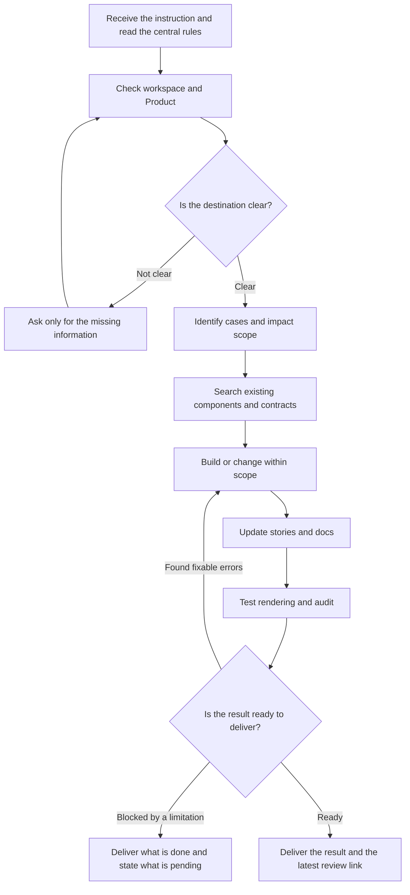
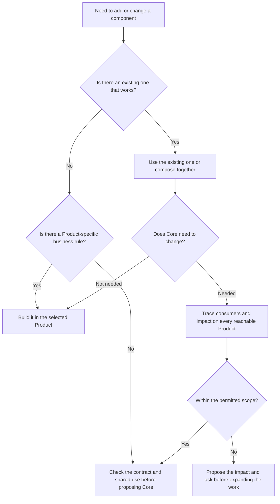
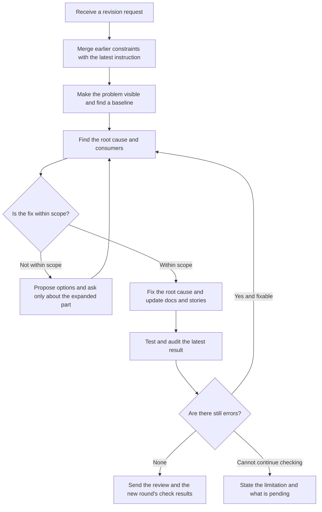

# Workflow for creating and changing UI

Shared by Codex and Claude Code in this workspace. Updated 25 November 2026

## When to use

The flows and document locations are collected in the [Workflow index](../docs/UI-WORKFLOW-INDEX.md). When a component is changed in Figma and the code is updated to match, use [Figma component → Code](figma-component-to-code-flow.md) together with the main steps below

Use when creating a screen/component, composing a screen from the DS, fixing a design or UI bug, changing styles/tokens, or refactoring UI code, even when the intent is to keep the current look. Do not use for documentation-only work or backend work that does not affect the UI

Read `rules/agent-rules.md` for the project rules, `DESIGN.md` for visual guidance and `rules/core-rules.md` for implementation rules. Do not copy design values here to create a new set in this workflow

## 1. Understand the work and check the current state

- Identify the Product/mode, the page or component, the requested output (code, Figma or both) and the constraints from the latest instruction. Use what is already known from the chat and the source first. Ask only when the missing information genuinely prevents further decisions
- Read the target files, imports, stories and related docs. Check the working changes before writing, and preserve the work of the other person/AI. Do not chase refactors outside the scope
- State the direction and what will be done in a few words. For UI work that is already permitted, proceed within the scope; do not add an approval point at every step
- Check the skills and tools that actually exist against the table at the end of the file. **Read the Stories skill first before changing any UI** if it exists in that session/machine. Follow the CLI help of the installed version; do not guess payloads, props or story IDs

## 2. Plan cases according to the size of the work

- For a new screen/flow use the case-planning section of `component-reuse-check`: look at the happy path and only the relevant loading, empty, error/retry, validation, disabled, success, permissions and long/missing data cases. For a small spot fix, check the broken case and nearby consumers; do not expand it into a new flow
- Separate **confirmed / proposed addition / must ask** based on evidence from the requirements and existing behavior. Do not invent business rules, user permissions or backend outcomes
- Define an observable expected result and a way to open each case through stories/preview. Use existing IDs when they exist. Do not claim there is a board covering every case if one has not been built
- If a business rule must be asked about, continue with the parts that do not depend on the answer, but do not guess the answer or treat silence as approval

## 3. Find existing things before creating

- Use `component-reuse-check` to search Core → current Product → other Products that are reachable according to ownership, including sub-parts such as sidebar, field, modal, pagination and icons. Capture the planned control-to-DS map before implementation and recheck native interactive JSX afterward; a raw HTML control with no DS comparison is an incomplete reuse check.
- Use the Storybook documentation tools to see real props/examples when available, and follow imports to the implementation to confirm that you are actually reusing the component, not one that merely looks the same
- Choose existing component → composition → necessary extension → new component with a reason. Before writing, leave a compact control-to-DS map in the work plan: interactive role → actual DS candidate/import and contract, or a justified gap. After writing, compare native interactive JSX (`button`, `input`, `textarea`, `select`, `a`) against this map. Native elements are valid when no compatible DS component exists or native semantics are required; record the specific reason. Resolve unexplained equivalents before delivery. This is not a ban on semantic HTML. Use the order of reference sources and the rules for adopting external components from `rules/agent-rules.md` and `rules/component-adoption-flow.md`

## 4. Design and write code

- Read `skills/unslop/SKILL.md` automatically to organize hierarchy, spacing and tidiness. Use the direction from the Product and the DS you have; do not let a generic recipe override the central rules. For a spot fix, adjust only that part
- For shadcn work use the `shadcn` skill and the real Base UI contract. Follow the Core/composed/Product locations and the split into hook/model/fixtures according to the project rules and the structure in use
- Use approved props, tokens, fonts, geometry and spacing scale. Do not change Core more broadly just to fix one page. If a shared component must change, trace its consumers and report the cross-Product impact
- Keep behavior/content when the work is a visual fix or refactor. Do not automatically start UX writing, move stacks, add dependencies or change APIs because a reference suggests it
- If Figma variables are changed, follow `rules/figma-variable-change-flow.md` for reading/comparing/updating, then continue with this workflow's check and report steps without re-running the same audit
- Use Figma output only for the destination and direction that are part of the task. The default when a sync is requested is code → Figma, but a UI code change does not mean Figma must be written every time. Figma-first work does not force writing code unless asked. Check the relevant Figma skill before using the tools

## 5. Update stories and docs

- After changing a component, always check the related docs. Use `document` to update the contract/examples/limitations that changed. Do not create new Markdown for every component when a suitable destination already exists
- Add or adjust colocated stories for the changed component so it can be opened, with interactions for important behavior. Use the case coverage from step 2 and keep existing story IDs
- If Core is added/removed, update the coverage list and check `npm run storybook:coverage`. Verify the stories are actually registered in Storybook; having the file does not mean it can be opened
- Docs must separate what is implemented from proposal/mock/Figma-only and from gaps that are not yet matched. Do not report that every case or every surface is synced without evidence

## 6. Check the real result and fix what is found

- After writing, check reuse for duplicate components or hand-built equivalents that slipped in, then run `component-audit` on the final result and the affected consumers, including pages and portals such as modal/popover when relevant
- Check rendering within scope: desktop/mobile, long Thai text, wrapping/overflow, missing data, keyboard/focus, icon/text alignment and state transitions. Compare the same role/variant/size; do not force every size to look identical
- For UI code work use the checks the central rules specify: build, token check, Storybook build and interaction tests through the installed Storybook `test-run`. Add the coverage check when Core changes. Do not re-run existing checks when no files changed and there is no new doubt. For Figma-only work use the relevant node/variables/render checks and say that code was not checked
- Test risky cases or real bugs; do not write tests that only check constants or the same import. If a test fails, fix it and re-test within the permitted scope. Never disable tests/a11y or lower the threshold to make them pass
- Report contrast/token problems that need an upstream decision; do not override colors per page to make them pass, and do not call passing interaction tests a full accessibility pass
- The same check results can be shared; do not re-run an audit just because another skill references it. Keep duplicate-search work, code QA and Figma parity clearly separate

## 7. Deliver with evidence

- Briefly state what changed, which existing component was used, which doc/story was updated, what checks passed/failed/could not be run, and what is pending
- Skill reports use the format in `.agents/skills/component-audit/references/report-format.md`. Cite real files or results; do not invent scores or check results
- When UI code changes, use the Stories workflow to look up story IDs from the tools and publish a review of the latest round, including all new stories. Send the link as the tool instructs. Do not use an old review or make up a URL
- Do not claim completion if a test still fails or an important part could not be checked. Report the blocker together with the finished work. Sending a preview is not publishing
- UI creation does not permit push/deploy/publish, release numbering, deleting legacy or returning to work the user has shelved, unless the user asks for it in that task. Workflow rules do not bypass permissions or tool denials

## Skills called by step

| Topic | Skill/location | Call when |
|---|---|---|
| Storybook docs, stories, tests and review | `stories` from the skills installed in the session | First, before changing UI, and used again in the check step |
| Case coverage | `.agents/skills/component-reuse-check/SKILL.md` (case-planning section) | Planning a new flow/cases or when requirements change |
| Flowchart/decision tree for the work | `skills/mermaid-diagrams/SKILL.md` | When a diagram is requested. Read the scope and limits from the central rules; do not draw one automatically for every task |
| Reuse and duplicates | `.agents/skills/component-reuse-check/SKILL.md` | Before writing and checking after writing |
| UI tidiness | `skills/unslop/SKILL.md` | Creating/adjusting UI within scope |
| React/shadcn | `.agents/skills/shadcn/SKILL.md` | Implementing code that uses shadcn |
| Component docs | `.agents/skills/document/SKILL.md` | Checking/updating the affected docs |
| Code QA and cross-surface | `.agents/skills/component-audit/SKILL.md` | Before sending changed UI code |
| Figma | The Figma skill for the task, as installed in the session | When the work has Figma output/read that needs tools |

The current `.agents/skills` location is a symlink to the old project's central set. Do not write through the symlink to change this workflow. If the other AI's machine lacks the skills, search the installed list and real locations first. Do not assume that every slash command, MCP or host path of Codex works with Claude

If a skill or tool is not found, state what is missing, do the parts that can be done with the central rules and the commands that exist, and state which steps could not be checked. Do not claim that a skill was called/tested/synced successfully. Do not quietly install skills or change the other AI's configuration

## Maintaining the rules going forward

Fix project constraints in `rules/agent-rules.md`, order and decision gates in `rules/workflow-map.md`, UI step details in this file, the look in `DESIGN.md` and specialist-flow details in the file that owns them. Update by cross-referencing files; do not copy them as another set of rules in AGENTS.md or CLAUDE.md. This is an instruction for the AI to follow, not background automation, a hook, or evidence that both AIs have run and tested this workflow

## Practical guide: choosing work and projects

This section expands steps 1–7 above; it is not another workflow. Readers are designers, developers, Codex and Claude, so that they know what the next task requires. Read the flowchart from top to bottom. Boxes are actions, diamonds are questions that branch the path, and arrows carry text stating the condition. Color is not used as the only status indicator

### Be clear about the word “project”

| Term | Meaning | What AI must check |
|---|---|---|
| Workspace/repository | The open code folder | absolute path, package.json, entry rules and the Git that actually exists |
| Product | A product inside the workspace, e.g. A/B | feature path, theme/mode and work owner |
| Core | Components/tokens shared by several Products | consumers and cross-Product impact |
| Figma DS file | A Product's library | file key/node and the mappings that actually exist |
| Figma design file | Screens that use that DS | destination file key/page/node; do not guess from the DS file |

A Product is not the same as a theme mode, and a name found in an old folder is not evidence that it is a current Product. Do not assume that A/B already exist in source

### Information needed before starting

AI should be able to summarize internally which workspace, which Product, which page/case is being changed, which side the output goes to, which theme is used, what must not change, and what evidence will be used to check the work. The user does not have to fill in a form every time

1. Use the latest instruction first, then the context selected in the chat, then check source/config to confirm
2. If there is only one Product consistent with the target files, state the assumption briefly and continue
3. If there are several Products and it cannot be determined where to write, ask once which Product to choose, and continue read-only searching meanwhile
4. Remember the Product within the task/chat until the user switches; do not ask again at every step, but do not claim that a new session will remember it by itself
5. If a Product name is given but the path or Figma mapping conflicts, resolve the ambiguity before writing to that destination
6. Opening a new workspace requires reading that workspace's rules anew; do not automatically carry over this workspace's runtime, branch, tokens or exceptions

Overview of receiving and delivering work:



### Multiple Products in one workspace

- Use the real structure from the central rules; do not create a new Core/Product folder set just to match the example in the plan
- Components with business logic, data formats or text specific to a Product live in that feature; they use Core through allowed dependencies
- The shared layer must be neutral toward Products; do not import A's screens/APIs into Core, and do not import B's internals into A just because they look alike
- If something similar is found in B, report it as a candidate and check the contract first. Propose moving it to a shared composition only when there is a reason; do not promote it on your own based on how many times it has been seen
- A-only work starts by checking and fixing A. If the root cause is in Core, do an impact analysis first; do not quietly change B or change the theme for every Product
- If a compatible Core change is needed to fix a bug within the task, report the impact and check the affected consumers. If a public API or another Product's behavior must change and that was not permitted, propose options and ask before the part that expands the scope
- If B cannot be accessed, say that only A/Core could be checked; do not claim B is unaffected

Choosing the scope of a component:



### Multiple repositories or multiple chats

1. Identify the name/path of the repository that owns the change, and check how the target project receives the DS from the real imports/package config. Do not assume that every app picks up a Core change immediately
2. Changing the DS repo is not updating an application repo; record both statuses separately, e.g. DS changed / A tried / B not yet checked
3. If using a package, check the actual version/lockfile; if using source imports, check the real path. During the Draft period do not create a release number yourself
4. When moving across chats or switching AI, send a handoff stating the workspace, Product, task scope, changed files, constraints, check results and pending steps. Do not use “continue from before” as the only information
5. Do not use a single central selected-product file that everyone overwrites. The Product selection must be the context of each person's work
6. If working at the same time, divide the file/work areas first. Colliding shared Core work must be coordinated with the owner; do not let another AI overwrite it just to make tests pass

## Practical guide: when there is a revision request

A new request during the work is an adjustment to the existing work, unless the user cancels or clearly changes the goal. Do not start over and do not drop earlier constraints

### Classify the request before changing

| Request | What to do next | What to preserve |
|---|---|---|
| “This overflows / is broken / the icon is wrong” | reproduce with the real case, then trace to the root cause | API, business behavior and unrelated areas |
| “Adjust this page's design” | check the Product recipe and use Unslop only within scope | tokens and component contracts per the central rules |
| “Change the shared component” | check variants/states/consumers and cross-Product impact | compatibility, or report a breaking change |
| “I changed colors/fonts/variables in Figma” | enter the existing variable-change flow | earlier snapshot, provenance and latest limitations |
| “Add a case” | add to case coverage and a suitable state/fixture/story | do not invent the business rule to make it complete |
| “refactor” | change how it is written following the structure, then compare behavior/render | look, API and transitions that were not asked to change |
| “Revert” | identify the change to undo and do a targeted revert | earlier work and other people's work |
| “Make it like the example” | separate reference aesthetics from the contract | our components and theme |
| “Stop / shelve it for now” | stop that work and record what is pending | do not publish or resume from old context |

### Order of each revision round

1. Read the new request together with the earlier constraints, e.g. do not change border/radius/props. Do not let the latest fix erase other constraints without an instruction
2. Identify the scope that changed from the previous round. Use the image/file/node as evidence. If the image cannot identify the real element, search consumers before asking
3. Reproduce and isolate the cause: wrong token/theme, wrong primitive recipe, wrong consumer override, wrong layout, mismatched fixture or wrong state logic. Do not guess the cause from the image alone
4. Keep a comparable baseline, e.g. story, viewport size, fixture, computed styles and test results. There is no need to back up the whole project every time
5. Fix at the smallest root-cause level. A page-level fix should not create a duplicate recipe. A Core fix must check wider impact according to the real dependencies
6. Add a regression test when it is a bug with important behavior/geometry that can really be tested. Do not write a test merely to confirm the literal that was just fixed
7. Update docs and stories to match the final behavior; remove outdated descriptions within the task scope. Do not write the history of every attempt into usage docs
8. Run focused tests and check the affected surfaces, then the required checks per step 6. If anything is changed again after checking, test the newly affected parts again
9. Send a new review round, summarizing “cause / what was fixed / what was checked / what is pending”. Do not send an image or review from before the fix in place of the latest one

This loop applies to revision requests during the work and after delivery:



### Fixing only an example vs. fixing the whole system

- “This page” means the target surface; it does not permit redesigning all of Core
- “Every button” must have its scope determined from context as this Product or Core. If the answers differ and it affects the writing, ask first
- “Make them the same” means compare the same semantic role/variant/size; do not make every variant identical to the point of losing states
- If fixing in Figma, check the component set, main component, instances and overrides concerned, as permitted. Never say every instance was fixed from fixing a single example
- If only code was changed, do not report that Figma is updated, and vice versa. If there is no mapping, say that parity cannot be checked
- When code and Figma conflict, separate implemented behavior from the approved visual spec; do not rigidly pick one side to win on everything

### Reverting and experimenting without adopting into Core

A request to “try” permits a prototype within scope but is not adoption into Core or publication. Use the existing experiment area and say it is a draft. If there is no sandbox yet, separate the Product/experiment files clearly; do not claim that an automatic save slots/playground system already exists

When the user does not want it, back out only the experiment's diff. Check the latest working changes first. Never reset the whole repo or restore files over another AI's work. After backing out, verify that imports/stories/docs do not reference what was removed. If the revert point cannot be identified, ask; do not guess a slot/commit

## Examples of how to give instructions

The user does not need to name skills or test commands; the AI must route by itself. The following examples are templates, not Products that have been created:

| Case | Example instruction |
|---|---|
| Start a Product | “This round, work on Product A in the folder … use theme … build the appointment list page in code” |
| Continue in the same Product | “Add the empty and load-failed cases to this page” |
| Switch Product | “Switch to Product B first, fix the dashboard page, do not touch A's” |
| Multiple repositories | “Fix Core in repo … then try it in A at … B does not need changes yet” |
| Spot fix | “Fix the long Thai name overflowing on mobile; keep the rest of the look unchanged” |
| Change Core | “Adjust the shared Button and check every affected consumer in both A and B” |
| Adjust Figma | “Edit only Figma per this node, use the existing DS, do not change code” |
| Two-way sync | “Sync this component from code to the DS file … and the example page in the design file …” |
| Try a design | “Make an experimental version in another direction, compare with the original, do not adopt it into Core yet” |
| Stop/revert | “Shelve this for now” or “Back out only the latest round of adjustments, keep the earlier fixes” |
| Hand off to another AI | “Read this task's handoff and continue only the pending steps; do not start a new implementation” |

## Handoff notes and work status

For large work, several Products or handoff across AIs, keep a note at `docs/work-in-progress/<task-name>.md` when needed. It is task-specific, not a central rules file, and need not be created for every short question. The name is an example of where it would be created when there is work, not a claim that a task tracking system exists

Minimum information in the note:

```text
Task / date updated:
Workspace and Product/mode:
Work owner and file areas responsible:
Goal / out of scope:
Constraints and user decisions:
Code paths / Figma DS and design destination:
Cases confirmed / proposed / still to ask:
Files and what has changed:
Latest check results, with command/evidence and time checked:
Pre-existing errors / errors from this work:
Pending / next step:
Status: in progress / awaiting answer / paused / ready for check / done within scope
```

Do not put secrets or credentials in the note. Before the next AI makes changes, it must read the real source and check whether it matches the handoff. A handoff is not a lock and is not permission to expand the work. If there is a difference, reconcile it first. Do not use the status “done” in place of test results

## When to ask and when to continue

| Situation | Action |
|---|---|
| Already know which Product/destination | Continue; do not ask again |
| Normal implementation adjustments within permitted work | Briefly state the direction and continue |
| There is a value from the DS and a clear contract | Use the existing value; do not make the user come up with new numbers |
| Do not know whether to write to Product A or B | Search the context first; if still undecidable, ask |
| A business rule must be decided or permissions changed | Ask and wait for the parts that depend on the answer |
| Need to extend the API/change another Product's behavior | Propose the impact and ask for the scope first |
| Cannot access Figma/skill/consumer | Continue the independent parts and state what could not be checked |
| A tool denies an action | Respect the reason for the denial; do not change the method to get around permissions |
| Need to publish but the user only said to try the UI | Do not publish |
| User pauses the work | Stop that work, keep the status, do not resume by yourself |

## Evidence before considering the work finished

UI creation/change work must state the target actually delivered, the agreed coverage, the reuse checked, the docs/stories updated and the final check results. If limitations remain, set the status truthfully. The main page looking good does not prove that the modal/mobile/every Product passes. Figma-only work does not need to claim that the code build passed from an earlier round

This is a document of instructions and diagrams; it does not install a watcher, board, auto-sync, task lock or automatic orchestration between AIs

### Diagram review record

Author: Codex following the mermaid-diagrams skill / Date: 25 November 2026 / Readers: DS team and both AIs / Goal: Markdown that supports Mermaid / Format: flowchart TD split into three questions / Alternative text: the tables and steps in the same section / Sources: the workflow and requirements in this workspace / Uncertainty: Product A/B and example paths are templates, not an implemented system / Check status: structure and paths checked by reading; parser or render in the target renderer not yet confirmed. Do not claim the rendered diagram passes until it has actually been tested
