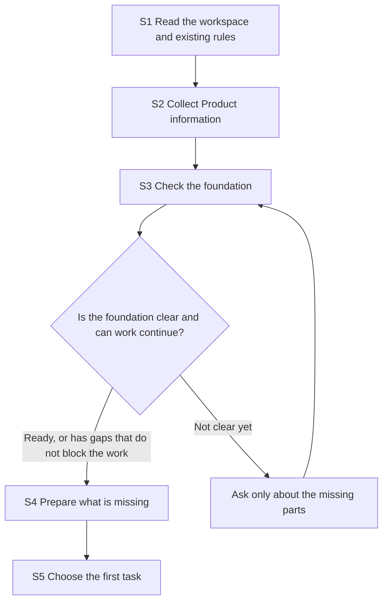
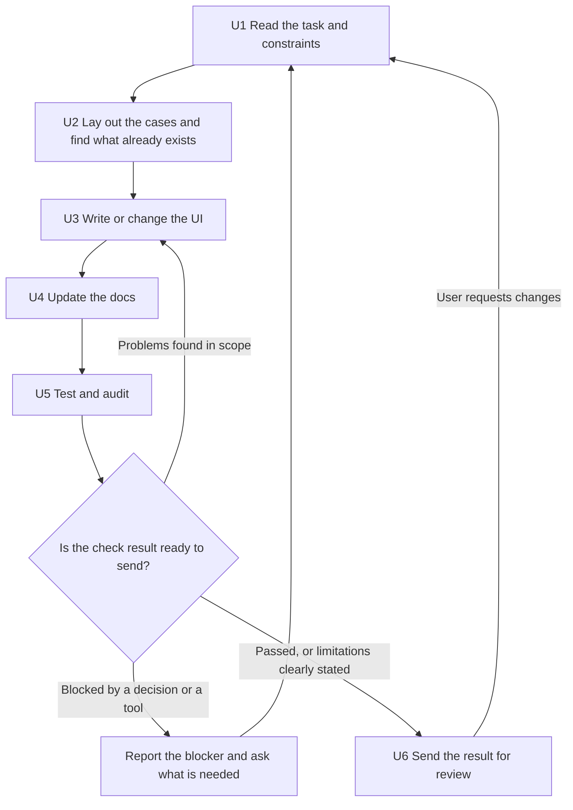
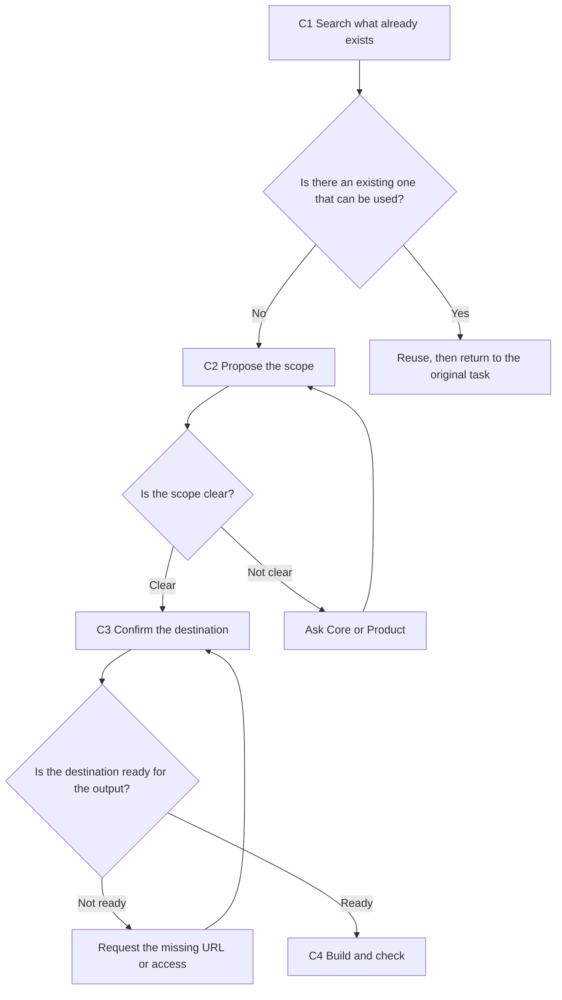
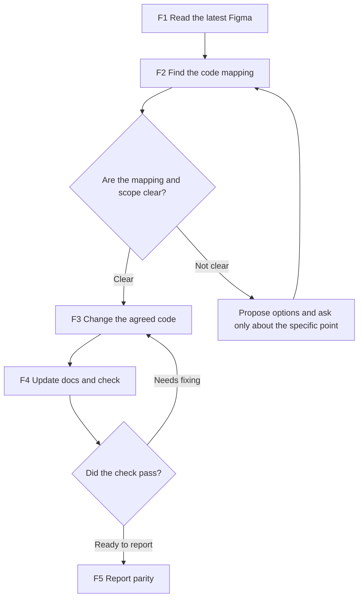
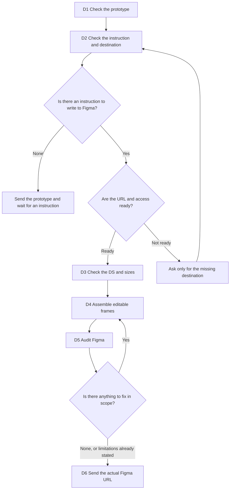
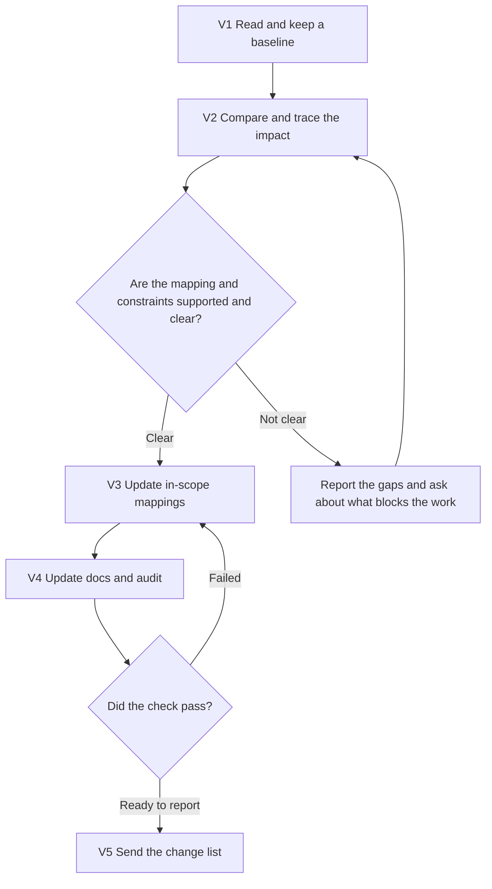
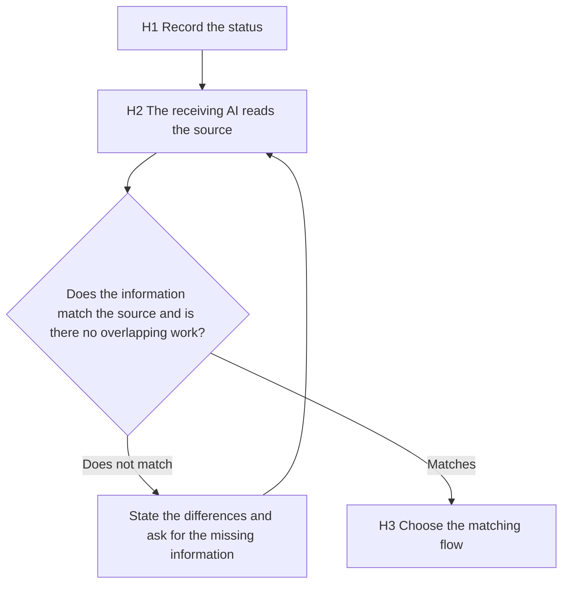

# Workflow map and the rules for each step

Updated 26 November 2026. For designers and AIs (both Codex and Claude) to read before choosing work in an existing or new project.

Imported from the design-prototype-project bundle (version 2) on 26 November 2026, **keeping all of this repo's existing rules** and not overwriting them: this file owns the **order of steps and the decision points**, while implementation detail lives in the files under `rules/` as listed in the "Supporting details" column and in the "Additional requirements for this repo" section at the end of the file.

Read top to bottom: rectangle = task, diamond = condition, text on a line = choice. Step codes match the tables below. The tables are a text description for when the renderer does not display Mermaid.

## Shared rules

- This document owns the order and the decision gates; the specialist files hold implementation detail. Read them together. If they conflict with the user's latest instruction or the workspace rules, disclose the conflict; do not silently pick one.
- “Ask/wait” pauses only the work that depends on the answer; independent work that is permitted may continue. Silence is not approval. Do not ask again when a valid answer already exists.
- Report missing tools/access as they are. Do not bypass permissions, invent props/mapping/URLs, or say a check step passed. A check result that cannot be used may be sent as partial status, but never call that work complete.
- Failures in scope must be fixed before finishing. If blocked by something out of scope, deliver the result with the blocker and what was done; do not skip a gate to claim success.
- Fix requests/feedback return to the same flow with the same constraints. Approval of the look does not automatically permit a publish or a Figma write.

## Choose a flow

| Task | Read section | Supporting details |
|---|---|---|
| Start a project/Product | Project setup | [new-project-guide.md](new-project-guide.md) and [product-setup-flow.md](product-setup-flow.md) |
| Create/change UI or Canvas | Create and change UI | [ui-workflow.md](ui-workflow.md) |
| A new component is needed | Add a component | [core-rules.md](core-rules.md), [component-adoption-flow.md](component-adoption-flow.md) and [FIGMA-NAMING.md](../docs/components/FIGMA-NAMING.md) |
| Figma changed, update code | Figma to Code | [figma-component-to-code-flow.md](figma-component-to-code-flow.md) |
| Bring a prototype to Figma | Code to Figma | [code-to-design-flow.md](code-to-design-flow.md) |
| Change variables | Change Figma variables | [figma-variable-change-flow.md](figma-variable-change-flow.md) |
| Change the AI doing the work | Hand work off to an AI | [TASK-HANDOFF.md](../docs/handoff/TASK-HANDOFF.md) and the "Handoff notes" section in [ui-workflow.md](ui-workflow.md) |

## Project setup

**Starts when:** a new workspace or Product is started

| Step | Skill | What to do | Outcome and condition to continue |
|---|---|---|---|
| S1 Read the workspace and existing rules | — | Check the source, working changes, Product records and the latest instruction | Know whether the project is existing or new; do not scaffold over existing work |
| S2 Collect Product information | — | Ask only for the Product name and any missing central DS / Product DS / design file URLs | Record separately per Product; "not yet created" and "central only" are valid answers |
| S3 Check the foundation | component-reuse-check | Read ds-foundation.md; check the code base, DESIGN.md, tokens, docs, stories, mapping and tools | Separate into present / missing / inaccessible; if the stack is unclear, propose and ask |
| S4 Prepare what is missing | create-project (when a prototype is needed) | Do only the scaffolding that is permitted; do not build the whole component set | A readiness summary and clearly stated blockers exist |
| S5 Choose the first task | — | After the readiness summary, ask which page or flow and the design/code direction; use an existing answer if there is one | Ready to enter the UI or Figma flow; pause only the work that depends on a blocker |

## Create and change UI

**Starts when:** asked to create a page, change the look, or refactor UI

| Step | Skill | What to do | Outcome and condition to continue |
|---|---|---|---|
| U1 Read the task and constraints | — | Identify the Product, code/Figma/docs scope, visual authority and what must not change | Edit only what is permitted; sending to Figma is not automatic |
| U2 Lay out the cases and find what already exists | component-reuse-check (case planning) | Separate confirmed/proposed/unresolved; check actual components and props | A case list and reuse plan exist; a missing component goes to the Component flow |
| U3 Write or change the UI | shadcn, unslop; emil-design-eng if motion | Use existing tokens/contracts; keep mock data separate from real business rules | A prototype exists for review; do not change Core beyond scope |
| U4 Update the docs | document | Check the related Markdown, Storybook and Figma docs; update the destinations that are in scope | State what was updated and what is pending; a description does not replace an on-canvas doc |
| U5 Test and audit | component-audit | Check render, states, keyboard, responsive, reuse and the actual checks | If an in-scope error is found, return to U3; if a decision is needed, ask |
| U6 Send the result for review | — | Send the latest preview/review with the check results and limitations | Do not claim everything passed when there is a fail/unverified item; feedback returns to U1 |

## Add a component

**Starts when:** existing reuse or composition does not meet the need

| Step | Skill | What to do | Outcome and condition to continue |
|---|---|---|---|
| C1 Search what already exists | component-reuse-check | Search Core, then Product, and check the actual variants/subcomponents | If an existing one works, finish with reuse; do not create a duplicate |
| C2 Propose the scope | component-reuse-check, shadcn (official shadcn search) | Recommend Core or Product with reasons based on shared use and domain | Do not promote Product to Core on your own; if unclear, ask |
| C3 Confirm the destination | — | If writing to Figma, an agreed destination DS URL is required; code-only uses a source path | An existing answer may be reused; check access before writing; if there is no URL yet, wait on the Figma part only |
| C4 Build and check | shadcn, unslop, document, component-audit | Build the necessary subset, then go through U4/U5 and audit Figma if it was written | Docs/checks/actual node URL exist, or the real limitations are stated |

## Figma to Code

**Starts when:** the user gives a URL and asks to implement or sync to the code side

| Step | Skill | What to do | Outcome and condition to continue |
|---|---|---|---|
| F1 Read the latest Figma | figma:figma-design-to-code + audit (binding evidence gate) | Check the node, main component/override, variants, bindings and layout | Know the actual source and scope; if access is not possible, report it; do not guess |
| F2 Find the code mapping | component-reuse-check, audit (map) | Find the equivalent and compare role/variant/size/behavior | If the mapping is unclear, propose and ask; do not assume identical names mean a match |
| F3 Change the agreed code | figma:figma-design-to-code, shadcn, unslop | Change the consumer or Core according to scope; do not push old code over Figma | Keep the approved API; a new API or an out-of-scope business rule needs agreement |
| F4 Update docs and check | document, component-audit | Use U4/U5 to test and compare the render with the requested Figma | In-scope problems go back to F3; conflicts go back to F2 |
| F5 Report parity | component-audit (report format) | State matches / still differs / cannot be checked, with evidence | Do not call it a complete sync while gaps remain |

## Code to Figma

**Starts when:** the prototype has passed review and the user asks to write to Figma

| Step | Skill | What to do | Outcome and condition to continue |
|---|---|---|---|
| D1 Check the prototype | component-audit | Read the source/render and the latest U4/U5 results; do not guess from old images | A code audit exists; if it has not passed, fix within scope first |
| D2 Check the instruction and destination | — | Check that a Figma write was actually requested; read the Product record, separating central DS/Product DS/design file | With no instruction, stop at the preview; if a URL is missing, ask and wait |
| D3 Check the DS and sizes | audit, component-reuse-check | Check actual library access, instances and approved desktop/tablet+mobile widths | A missing component goes to the Component flow; if sizes are not yet agreed, propose and ask |
| D4 Assemble editable frames | code-to-figma | Use actual DS instances/variables/Auto Layout for the agreed pages or states | Do not substitute a screenshot or a detached lookalike; do not publish the library on your own |
| D5 Audit Figma | audit | Check linkage, tokens, variants, layout and an image comparison against the prototype | In-scope problems go back to D4; report unsupported linkage |
| D6 Send the actual Figma URL | code-to-figma | State the nodes created/edited, sizes, interaction limitations and gaps | Finish when there is check evidence; a code audit does not stand in for a Figma audit |

## Change Figma variables

**Starts when:** the user reports that variables changed and asks to update the consumers

| Step | Skill | What to do | Outcome and condition to continue |
|---|---|---|---|
| V1 Read and keep a baseline | — | Read the accessible collections/modes/types/aliases and compare with the snapshot before overwriting | Do not delete the old baseline; if there is no baseline, report that this is the first time |
| V2 Compare and trace the impact | audit | Separate new changes from historical drift; find the mappings and consumers | Values that are unsupported or conflict with constraints need a targeted question |
| V3 Update in-scope mappings | — | Use the project's actual generator; do not edit generated files by hand | Do not guess missing mappings; do not claim a snapshot equals parity |
| V4 Update docs and audit | component-audit, document | Check the affected docs/stories/render together with regression checks | A fail goes back to V3; report unknowns; do not create a background watcher |
| V5 Send the change list | — | State old/new values, consumers, check results and unmapped gaps | Finish only within the confirmed scope |

## Hand work off to an AI

**Starts when:** the person doing the work changes or the work is sent to another repository

| Step | Skill | What to do | Outcome and condition to continue |
|---|---|---|---|
| H1 Record the status | — | Fill in TASK-HANDOFF.md with Product/scope/constraints/actual checks/pending | Do not include secrets; do not claim a check passed without evidence |
| H2 The receiving AI reads the source | — | Read the entry rules and working changes; compare the report with the actual state | If there is a conflict/overlapping work, ask only about that part; do not overwrite |
| H3 Choose the matching flow | — | Enter the setup/UI/Figma flow according to the current request | Do not resume paused work; a handoff is not permission to publish |

## Skills used at each step

Each flow table above has a **Skill** column: load that skill when the step starts (not for the whole task); "—" means no skill, only the rules and tools named in the row. The same list in one place; one owner per step (see `rules/skill-routing.md` at the repo root for boundaries). A skill is loaded when its step starts, not for the whole task.

| Step | Skill |
|---|---|
| S3 Check the foundation | component-reuse-check |
| S4 Prepare what is missing | create-project (when a prototype is needed) |
| C1 Search what already exists; U2 Lay out the cases | component-reuse-check (includes case planning) |
| U3 / C4 / F3 Write or change the UI | shadcn, unslop (automatic); emil-design-eng when motion is involved |
| U4 Update the docs | document |
| U5 / F4 Test and audit (code) | component-audit |
| F1–F2 / D5 / V2 Check or fix the Figma side | audit (token binding, naming, screen QA, map/fix) |
| D1–D6 Code to Figma | code-to-figma, then the installed Figma plugin skills |
| F1–F5 Figma to Code | figma:figma-design-to-code (plugin), then shadcn |
| Map components to Code Connect (after F3/C4, rename, move) | figma:figma-code-connect (plugin; load before mapping, publish only with user authorization) |
| Before merge / PR | pr-checklist (includes the changelog entry) |
| Draw a flow for a designer | artifact-diagramming; plain Mermaid in Markdown when it must stay as text in the repo |

Outside the main flows and used only when asked: rename-frame, localization-export, impeccable (critique/audit/polish of an existing interface), ui-ux-pro-max (style, palette, font and chart lookups; reference only).

## How to have the AI follow a flow

Start by stating the flow name and the current step code (for example "Figma to Code, F2"). Then load the skill named in that step's **Skill** column (if any) before doing the step. Use each flow's table as the pass criteria for each step. If a step is skipped, cite evidence that the work already exists. Do not translate "has documentation" as "implemented/tested". Show Mermaid when explaining the overall picture, and keep the actual results in the handoff.

## Additional requirements for this repo

This section is not in the original bundle. It is this repo's own rules layered on top of the flows above, and it does not conflict with the step order:

- **Prototype PRs:** when the diff touches a Product prototype, the PR description lists full-page Storybook links (`<storybook preview URL>/iframe.html?id=<story-id>&viewMode=story`, no sidebar) built from real story IDs; see `pr-checklist` (Full-page prototype links). The Vercel preview needs a Vercel team login; say so and do not claim a link was opened unless it was.
- **Before opening or updating a PR, run `pr-checklist`** (it reuses the component-reuse-check and component-audit results for the same code revision and records the changelog entry), then report readiness; do not merge
- **Always ask the user before committing** and do not push until told to (after F4/F5, U6, D6 or V5 finish, before entering the commit step). See CLAUDE.md at the root
- **Figma to Code (F2 → F3):** make a "Figma name → code name" table following [FIGMA-NAMING.md](../docs/components/FIGMA-NAMING.md) and have the user confirm it before renaming any component or property in Figma, every time. Property names and values in Figma must equal the props and values in code. Writing to Figma requires an instruction, and the Desktop Bridge plugin must be open in the target file.
- **Load `figma:figma-code-connect` before mapping work. Every new component must always be connected to Code Connect (the user instructed this on 26 November 2026):** when a component/set that has matching code is created or renamed in Figma, create or update the `*.figma.tsx` map file in `shadcn/code-connect/` so that it covers every set of that component (Figma node URL → shadcn component, props and values per the table in [FIGMA-NAMING.md](../docs/components/FIGMA-NAMING.md)). Run `npm run code-connect:dry-run` (root), then publish with `npm run code-connect:publish` only with user authorization (reuse existing authorization), and check in Dev Mode before saying that component's work is done. If publishing is not possible (no token, Figma not connected), report it plainly as pending work; never skip it silently. A set that has no matching code must be reported as a gap. The shadcn map files live in `shadcn/code-connect/` and the config is `figma.config.json` (root). A Figma token is required in `.env.local` (the user adds it themselves). For a variant that code does not have (for example elevated, loading), map what exists and report the missing part.
- **Variables (V3):** update `tokens.json` only from live values in Figma, then run `npm run tokens:generate` and `npm run tokens:check` in the `shadcn/` folder. Do not guess or edit generated files by hand. If the live values cannot be read, stop and report.
- **Figma source of the DS:** the file "Cariva Core Design System" (`XgxprkSY5mGbzIIwlmscCt`); "[Shadcn] Cariva Core Design System" is no longer used
- **Checking tools (U5, F4):** the shadcn side currently has no automatic tool that measures render values against Figma. Report what can be measured, and call anything not yet measured "cannot be checked" per the F5 rule.
- **Do not write new code into `legacy/mui/`**, and sample pages are not kept in `shadcn/` (only components, tokens and the catalog are kept)
- **Look-and-feel reference sources when no component exists (C1–C2):** in the order already agreed in `agent-rules.md` under "Adopting external components" (the user reconfirmed on 26 November 2026): (1) our own Core/Product DS → (2) official shadcn/ui → (3) [ReUI](https://reui.io/components) as an additional reference example. If the user supplies an image or reference link in the instruction, use that first. ReUI is a shadcn registry with an MIT license as the website states (the license page has not been read yet); it is not an npm package. Use it with `npx shadcn@latest add`, which copies the source into the project
  - ReUI is only a **reference example, not the source of the look**. When there is a design in Figma, Figma wins, and adapt per [component-adoption-flow.md](component-adoption-flow.md): use our radius, height, padding, colors, fonts and tokens; do not take ReUI's values as they are.
  - Our base is Base UI (`components.json`: base-maia). ReUI has both a Base UI and a Radix version; use the Base UI version, and do not add Radix.
  - **Always ask before running `npx shadcn add`** because some components pull in extra packages (for example `@tanstack/react-table`, `@dnd-kit`, `recharts`); adding a dependency requires permission
  - If ReUI does not have it either, or the look is still unclear, ask the user before creating it; do not guess
