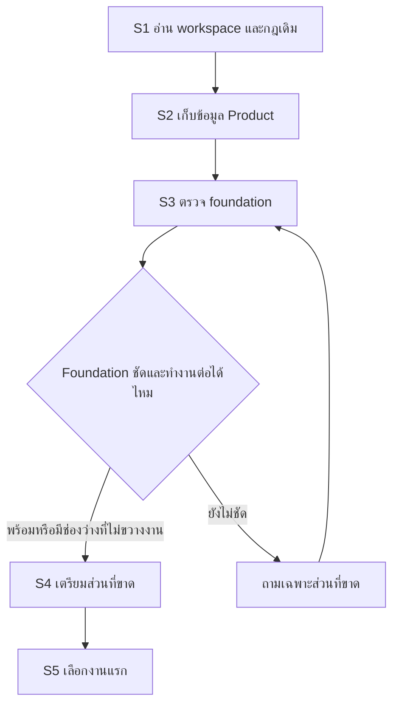
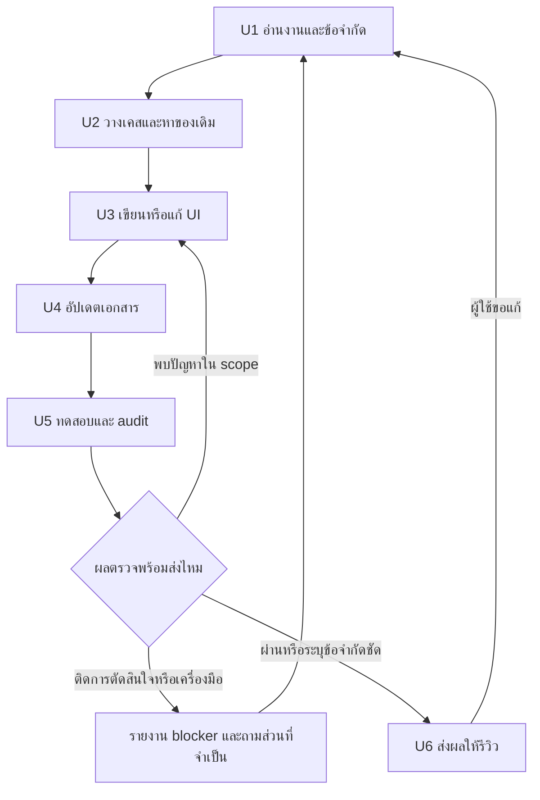
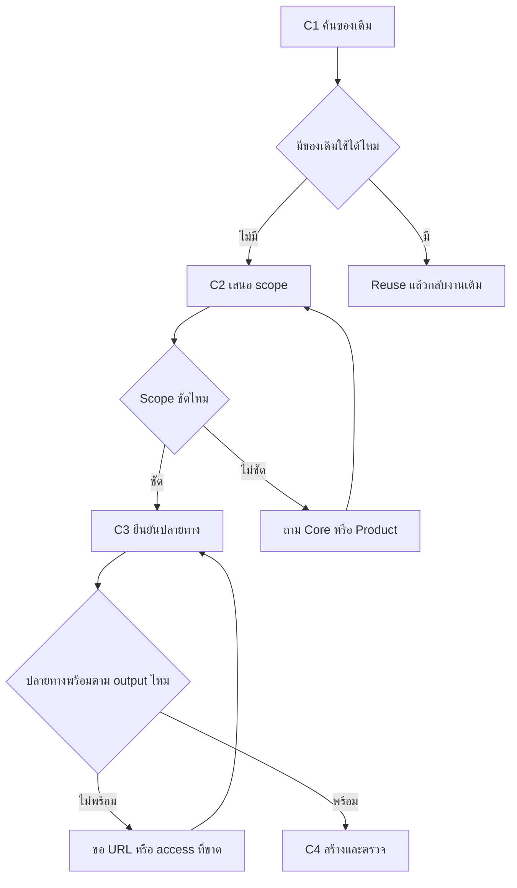
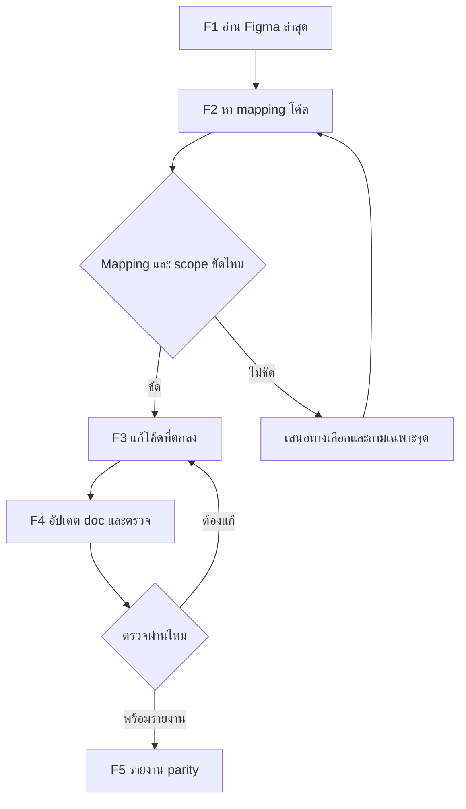
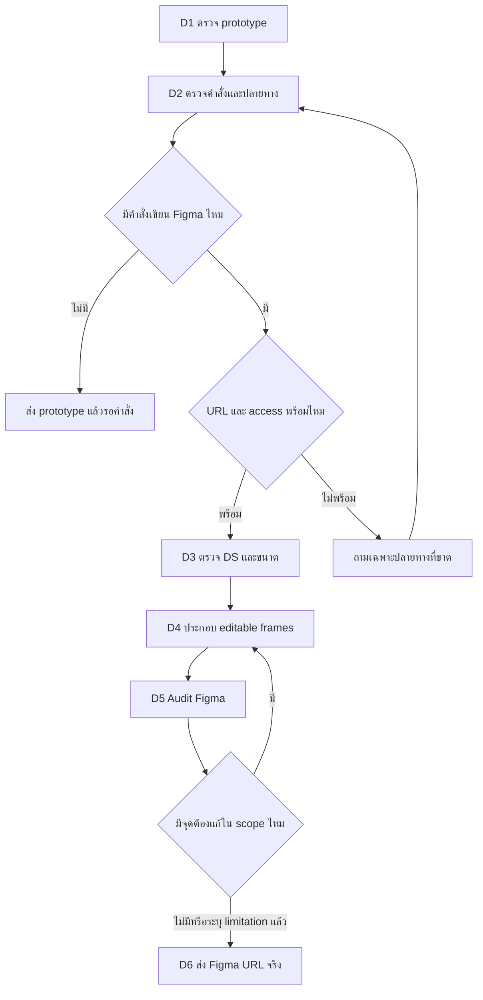
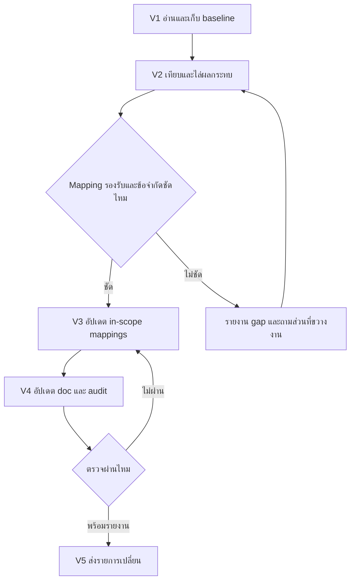
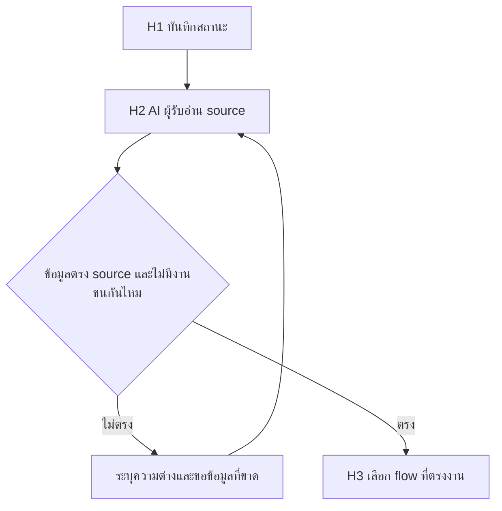

# Workflow map และกติกาแต่ละขั้น

อัปเดต 26 พฤศจิกายน 2026 สำหรับ designer และ AI ทั้ง Codex/Claude ใช้อ่านก่อนเลือกทำงานในโปรเจกต์เดิมหรือใหม่

นำเข้าจากชุด design-prototype-project (เวอร์ชัน 2) เมื่อ 26 พฤศจิกายน 2026 โดย **รักษากฎเดิมของ repo นี้ไว้ทั้งหมด** ไม่ได้เขียนทับ: ไฟล์นี้เป็นเจ้าของ **ลำดับขั้นและจุดตัดสินใจ** ส่วนรายละเอียดการทำอยู่ในไฟล์ใน `rules/` ตามคอลัมน์ "รายละเอียดประกอบ" และส่วน "ข้อกำหนดเพิ่มของ repo นี้" ท้ายไฟล์

อ่านจากบนลงล่าง: สี่เหลี่ยม = งาน, ข้าวหลามตัด = เงื่อนไข, ข้อความบนเส้น = ทางเลือก รหัสขั้นตรงกับตารางด้านล่าง ตารางเป็นคำอธิบายแบบข้อความเมื่อ renderer ไม่แสดง Mermaid

## กติกาใช้ร่วมกัน

- เอกสารนี้เป็นเจ้าของลำดับและ decision gates; specialist files เป็นรายละเอียด implementation อ่านคู่กัน หากขัดกับคำสั่งผู้ใช้ล่าสุดหรือกฎ workspace ให้เปิดเผยข้อขัดแย้ง ไม่เงียบเลือกเอง
- คำว่า “ถาม/รอ” หยุดเฉพาะงานที่ขึ้นกับคำตอบ งานอิสระที่ได้รับอนุญาตทำต่อได้ ความเงียบไม่ใช่คำอนุมัติ ไม่ถามซ้ำเมื่อมีคำตอบที่ยังใช้ได้
- Missing tools/access ให้รายงานตามจริง อย่า bypass permissions, แต่ง props/mapping/URLs หรือบอกว่าขั้นตรวจผ่าน ใช้ผลตรวจไม่ได้และส่ง partial status ได้ แต่ห้ามเรียกงานนั้น complete
- ต้องแก้ failures ใน scope ก่อนจบ หากติดปัญหานอก scope ให้ส่งผลแบบมี blocker พร้อมสิ่งที่ทำแล้ว ไม่ข้าม gate เพื่ออ้างสำเร็จ
- คำขอแก้/feedback ย้อนเข้า flow เดิมพร้อมข้อจำกัดเดิม การอนุมัติหน้าตาไม่อนุญาต publish หรือ Figma write โดยอัตโนมัติ

## เลือก flow

| งาน | อ่านส่วน | รายละเอียดประกอบ |
|---|---|---|
| เริ่มโปรเจกต์/Product | Setup | [new-project-guide.md](new-project-guide.md) และ [product-setup-flow.md](product-setup-flow.md) |
| สร้าง/แก้ UI หรือ Canvas | UI | [ui-workflow.md](ui-workflow.md) |
| ต้องมี component ใหม่ | Component | [core-rules.md](core-rules.md), [component-adoption-flow.md](component-adoption-flow.md) และ [FIGMA-NAMING.md](../docs/components/FIGMA-NAMING.md) |
| Figma เปลี่ยนแล้วแก้ code | Figma ไป Code | [figma-component-to-code-flow.md](figma-component-to-code-flow.md) |
| นำ prototype ไป Figma | Code ไป Figma | [code-to-design-flow.md](code-to-design-flow.md) |
| เปลี่ยน variables | Variables | [figma-variable-change-flow.md](figma-variable-change-flow.md) |
| เปลี่ยน AI ผู้ทำงาน | Handoff | [TASK-HANDOFF.md](../docs/handoff/TASK-HANDOFF.md) และส่วน "บันทึกส่งต่อ" ใน [ui-workflow.md](ui-workflow.md) |

## Setup โปรเจกต์

**เริ่มเมื่อ:** เมื่อเริ่ม workspace หรือ Product ใหม่

| ขั้น | ต้องทำ | ผลลัพธ์และเงื่อนไขไปต่อ |
|---|---|---|
| S1 อ่าน workspace และกฎเดิม | ตรวจ source, working changes, Product records และคำสั่งล่าสุด | ทราบว่าเป็นโปรเจกต์เดิมหรือใหม่ ห้าม scaffold ทับงาน |
| S2 เก็บข้อมูล Product | ขอเพียงชื่อ Product และ URL DS กลาง / DS Product / design file ที่ยังขาด | บันทึกแยก Product; ยังไม่มีและใช้กลางอย่างเดียวเป็นคำตอบที่ใช้ได้ |
| S3 ตรวจ foundation | อ่าน ds-foundation.md ตรวจ code base, DESIGN.md, tokens, docs, stories, mapping และ tools | แยกมีแล้ว / ขาด / เข้าถึงไม่ได้ ถ้า stack ไม่ชัดให้เสนอและถาม |
| S4 เตรียมส่วนที่ขาด | ทำเฉพาะ scaffold ที่ได้รับอนุญาต ไม่สร้าง component ทั้งชุด | มี readiness summary และ blocker ที่ระบุชัด |
| S5 เลือกงานแรก | ถามหน้าหรือ flow และทิศทาง design/code หลังสรุป readiness; ใช้คำตอบเดิมหากมี | พร้อมเข้า UI หรือ Figma flow; หยุดเฉพาะงานที่ขึ้นกับ blocker |

## สร้างและแก้ UI

**เริ่มเมื่อ:** เมื่อขอสร้างหน้า แก้หน้าตา หรือ refactor UI

| ขั้น | ต้องทำ | ผลลัพธ์และเงื่อนไขไปต่อ |
|---|---|---|
| U1 อ่านงานและข้อจำกัด | ระบุ Product, code/Figma/docs scope, visual authority และสิ่งที่ห้ามเปลี่ยน | แก้งานที่อนุญาตได้; ส่งไป Figma ไม่อัตโนมัติ |
| U2 วางเคสและหาของเดิม | แยก confirmed/proposed/unresolved; ตรวจ component และ props จริง | มีรายการเคสและ reuse plan; component ขาดเข้า component flow |
| U3 เขียนหรือแก้ UI | ใช้ tokens/contracts เดิม เก็บ mock data แยกจาก business rules จริง | มี prototype สำหรับตรวจ ไม่แก้ Core กว้างเกิน scope |
| U4 อัปเดตเอกสาร | ตรวจ Markdown, Storybook และ Figma docs ที่เกี่ยวข้อง อัปเดตปลายทางที่อยู่ใน scope | ระบุสิ่งอัปเดตและสิ่งค้าง; description ไม่แทน on-canvas doc |
| U5 ทดสอบและ audit | ตรวจ render, states, keyboard, responsive, reuse และ checks จริง | ถ้าพบข้อผิดพลาดใน scope กลับ U3; ถ้าต้องตัดสินใจให้ถาม |
| U6 ส่งผลให้รีวิว | ส่ง preview/review ล่าสุด พร้อมผลตรวจและข้อจำกัด | ไม่อ้างผ่านทั้งหมดเมื่อมี fail/unverified; รับ feedback กลับ U1 |

## เพิ่ม component

**เริ่มเมื่อ:** เมื่อ reuse หรือ composition เดิมไม่ตอบโจทย์

| ขั้น | ต้องทำ | ผลลัพธ์และเงื่อนไขไปต่อ |
|---|---|---|
| C1 ค้นของเดิม | ค้น Core แล้ว Product และตรวจ variants/subcomponents จริง | ใช้ของเดิมได้ให้จบด้วย reuse ไม่สร้างซ้ำ |
| C2 เสนอ scope | แนะนำ Core หรือ Product พร้อมเหตุผลด้านการใช้ร่วมและ domain | ไม่ promote Product เข้า Core เอง ถ้าไม่ชัดให้ถาม |
| C3 ยืนยันปลายทาง | ถ้าเขียน Figma ต้องมี URL DS ปลายทางที่ตกลงแล้ว; code-only ใช้ source path | ใช้คำตอบเดิมได้ ตรวจ access ก่อนเขียน; ยังไม่มี URL ให้รอเฉพาะ Figma |
| C4 สร้างและตรวจ | ทำ subset ที่จำเป็น แล้วเข้า U4/U5 และ audit Figma หากเขียน | มี docs/checks/actual node URL หรือบอกข้อจำกัดจริง |

## Figma ไป Code

**เริ่มเมื่อ:** ผู้ใช้ให้ URL และขอ implement หรือ sync มาฝั่ง code

| ขั้น | ต้องทำ | ผลลัพธ์และเงื่อนไขไปต่อ |
|---|---|---|
| F1 อ่าน Figma ล่าสุด | ตรวจ node, main component/override, variants, bindings และ layout | รู้ source และ scope จริง; access ไม่ได้ให้รายงาน ไม่เดา |
| F2 หา mapping โค้ด | ค้น equivalent และเทียบ role/variant/size/behavior | ถ้า mapping ไม่ชัดเสนอแล้วถาม; ไม่ถือว่าชื่อเหมือนแปลว่าตรง |
| F3 แก้โค้ดที่ตกลง | แก้ consumer หรือ Core ตาม scope ไม่ส่งโค้ดเก่าทับ Figma | คง API ที่อนุมัติ; API ใหม่หรือ business rule นอก scope ต้องตกลง |
| F4 อัปเดต doc และตรวจ | ใช้ U4/U5 ทดสอบและเทียบ render กับ Figma ที่ขอ | ปัญหาใน scope กลับ F3; ข้อขัดแย้งกลับ F2 |
| F5 รายงาน parity | บอกตรงแล้ว / ยังต่าง / ตรวจไม่ได้ พร้อมหลักฐาน | ไม่เรียก sync สมบูรณ์ถ้ายังมี gap |

## Code ไป Figma

**เริ่มเมื่อ:** prototype ผ่านการรีวิวและผู้ใช้ขอเขียน Figma

| ขั้น | ต้องทำ | ผลลัพธ์และเงื่อนไขไปต่อ |
|---|---|---|
| D1 ตรวจ prototype | อ่าน source/render และผล U4/U5 ล่าสุด ไม่ใช้ภาพเก่าโดยเดา | มี code audit; ถ้ายังไม่ผ่านแก้ในขอบเขตก่อน |
| D2 ตรวจคำสั่งและปลายทาง | ตรวจว่าขอ Figma write จริง อ่าน Product record แยก DS กลาง/DS Product/design file | ไม่มีคำสั่งให้จบที่ preview; ขาด URL ให้ถามแล้วรอ |
| D3 ตรวจ DS และขนาด | ตรวจ actual library access, instances และ approved desktop/tablet+mobile widths | component ขาดเข้า component flow; ขนาดยังไม่ตกลงเสนอและถาม |
| D4 ประกอบ editable frames | ใช้ actual DS instances/variables/Auto Layout ตามหน้าหรือ states ที่ตกลง | ไม่แทนด้วย screenshot หรือ detached lookalike ไม่ publish library เอง |
| D5 Audit Figma | ตรวจ linkage, tokens, variants, layout และภาพเทียบ prototype | ปัญหาใน scope กลับ D4; unsupported linkage ให้รายงาน |
| D6 ส่ง Figma URL จริง | บอก node ที่สร้าง/แก้ ขนาด ข้อจำกัด interaction และ gap | จบเมื่อมีหลักฐานตรวจ ไม่ถือว่า code audit แทน Figma audit |

## เปลี่ยน Figma variables

**เริ่มเมื่อ:** เมื่อผู้ใช้แจ้งเปลี่ยน variables และขออัปเดต consumers

| ขั้น | ต้องทำ | ผลลัพธ์และเงื่อนไขไปต่อ |
|---|---|---|
| V1 อ่านและเก็บ baseline | อ่าน accessible collections/modes/types/aliases เทียบ snapshot ก่อนเขียนทับ | ไม่ลบ baseline เก่า; ไม่มี baseline ให้รายงานว่าเป็นครั้งแรก |
| V2 เทียบและไล่ผลกระทบ | แยก change ใหม่/historical drift หา mapping กับ consumers | ค่าที่ไม่รองรับหรือขัดข้อจำกัดต้องถามเฉพาะจุด |
| V3 อัปเดต in-scope mappings | ใช้ generator จริงตาม project ไม่แก้ generated files ด้วยมือ | ไม่เดา mapping ที่ขาด ไม่อ้าง snapshot เท่ากับ parity |
| V4 อัปเดต doc และ audit | ตรวจ docs/stories/render ที่ได้รับผลพร้อม regression checks | fail กลับ V3; unknown ให้รายงาน ไม่สร้าง background watcher |
| V5 ส่งรายการเปลี่ยน | บอกค่าเดิม/ใหม่ consumers ผลตรวจ และ unmapped gaps | จบใน scope ที่ยืนยันเท่านั้น |

## ส่งต่องานให้ AI

**เริ่มเมื่อ:** เมื่อเปลี่ยนผู้ทำงานหรือส่งไปอีก repository

| ขั้น | ต้องทำ | ผลลัพธ์และเงื่อนไขไปต่อ |
|---|---|---|
| H1 บันทึกสถานะ | กรอก TASK-HANDOFF.md ด้วย Product/scope/constraints/actual checks/pending | ไม่ใส่ secrets ไม่อ้างตรวจผ่านโดยไม่มีหลักฐาน |
| H2 AI ผู้รับอ่าน source | อ่าน entry rules และ working changes เทียบรายงานกับสถานะจริง | ถ้ามี conflict/งานชนกันให้ถามเฉพาะส่วน ไม่ overwrite |
| H3 เลือก flow ที่ตรงงาน | เข้า setup/UI/Figma flow ตามคำขอปัจจุบัน | ไม่ resume งานที่พักไว้ ไม่ถือว่า handoff อนุญาต publish |

## วิธีให้ AI ทำตาม flow

เริ่มด้วยระบุชื่อ flow และรหัสขั้นปัจจุบัน (เช่น "Figma ไป Code, F2") ใช้ตารางของแต่ละ flow เป็นเกณฑ์ผ่านแต่ละขั้น ถ้าข้ามขั้นให้ระบุหลักฐานว่างานนั้นมีอยู่แล้ว ไม่แปล "มีเอกสาร" เป็น "implement/test แล้ว" แสดง Mermaid เมื่ออธิบายภาพรวม และเก็บผลจริงใน handoff

## ข้อกำหนดเพิ่มของ repo นี้

ส่วนนี้ไม่มีในชุดต้นฉบับ เป็นกฎของ repo ที่ซ้อนอยู่บน flow ข้างบน ไม่ขัดกับลำดับขั้น:

- **ก่อน commit ต้องถามผู้ใช้เสมอ** และไม่ push จนกว่าจะสั่ง (หลังจบ F4/F5, U6, D6, V5 ก่อนเข้าขั้น commit) ดู CLAUDE.md ที่ root
- **Figma ไป Code (F2 → F3):** ทำตาราง "ชื่อ Figma → ชื่อโค้ด" ตาม [FIGMA-NAMING.md](../docs/components/FIGMA-NAMING.md) ให้ผู้ใช้ยืนยันก่อนเปลี่ยนชื่อ component หรือ property ใน Figma ทุกครั้ง ชื่อ property และค่าใน Figma ต้องเท่ากับ prop และค่าในโค้ด การเขียน Figma ต้องมีคำสั่ง และเปิดปลั๊กอิน Desktop Bridge ในไฟล์ปลายทาง
- **เชื่อม Code Connect (ขั้นต่อจาก F5 ของ repo นี้ ผู้ใช้ขอเพิ่มเมื่อ 26 พฤศจิกายน 2026):** เมื่อ audit ผ่านและผู้ใช้ยืนยัน ให้สร้างไฟล์ map `*.figma.tsx` ของ component นั้นใน `shadcn/code-connect/` (Figma node URL → component shadcn โดยจับคู่ชื่อและค่า property ตาม [FIGMA-NAMING.md](../docs/components/FIGMA-NAMING.md)) รัน `--dry-run` ก่อน แล้ว publish เมื่อผู้ใช้สั่งเท่านั้น ต้องมี Figma token ใน `.env.local` (ผู้ใช้ใส่เอง ผู้ช่วยกรอกให้ไม่ได้) และตรวจใน Dev Mode ก่อนบอกว่าเชื่อมแล้ว variant ที่โค้ดไม่มี (เช่น elevated, loading) map ไม่ได้ ให้รายงานเป็น gap mapping ของ MUI เดิมถูกลบแล้ว (26 พฤศจิกายน 2026; Figma รายงานว่าไม่มี mapping ค้างอยู่) ยังไม่เคยลองขั้นนี้กับ shadcn จริง และโฟลเดอร์ `shadcn/code-connect/` กับ config ใหม่ยังไม่ได้สร้าง
- **Variables (V3):** อัปเดต `tokens.json` จากค่าสดใน Figma เท่านั้น แล้วรัน `npm run tokens:generate` และ `npm run tokens:check` ในโฟลเดอร์ `shadcn/` ห้ามเดาหรือแก้ไฟล์ generated ด้วยมือ ถ้าอ่านค่าสดไม่ได้ให้หยุดแจ้ง
- **ต้นทาง Figma ของ DS:** ไฟล์ "Cariva Core Design System" (`XgxprkSY5mGbzIIwlmscCt`) ไม่ใช้ "[Shadcn] Cariva Core Design System" แล้ว
- **เครื่องตรวจ (U5, F4):** ตอนนี้ฝั่ง shadcn ยังไม่มีเครื่องวัดค่า render เทียบ Figma อัตโนมัติ ให้รายงานข้อที่วัดได้ และเรียกข้อที่ยังไม่ได้วัดว่า "ตรวจไม่ได้" ตามกติกา F5
- **ห้ามเขียนโค้ดใหม่ลง `legacy/mui/`** และหน้าตัวอย่างไม่เก็บไว้ใน `shadcn/` (เก็บเฉพาะ component, tokens, catalog)
- **แหล่งอ้างอิงหน้าตาเมื่อยังไม่มี component (C1–C2):** ตามลำดับที่ตกลงไว้แล้วใน `agent-rules.md` หัวข้อ "Adopting external components" (ผู้ใช้ยืนยันซ้ำเมื่อ 26 พฤศจิกายน 2026): (1) Core/Product DS ของเราเอง → (2) shadcn/ui ทางการ → (3) [ReUI](https://reui.io/components) เป็นตัวอย่างอ้างอิงเพิ่มเติม ถ้าผู้ใช้ให้ภาพหรือลิงก์อ้างอิงมาในคำสั่ง ให้ใช้อันนั้นก่อน ReUI เป็น registry ของ shadcn ใบอนุญาต MIT ตามที่หน้าเว็บระบุ (ยังไม่ได้เปิดอ่านหน้า license) ไม่ใช่แพ็กเกจ npm ใช้ด้วย `npx shadcn@latest add` ซึ่งคัดลอกซอร์สเข้าโปรเจกต์
  - ReUI เป็นแค่ **ตัวอย่างอ้างอิง ไม่ใช่ต้นทางหน้าตา** เมื่อมีดีไซน์ใน Figma ให้ Figma ชนะ และให้ปรับตาม [component-adoption-flow.md](component-adoption-flow.md): ใช้ radius, ความสูง, padding, สี, ฟอนต์ และ token ของเรา ไม่เอาค่าของ ReUI มาตรง ๆ
  - ฐานของเราคือ Base UI (`components.json`: base-maia) ReUI มีทั้งเวอร์ชัน Base UI และ Radix ให้ใช้เวอร์ชัน Base UI ห้ามเพิ่ม Radix
  - **ถามก่อนรัน `npx shadcn add` ทุกครั้ง** เพราะบาง component ดึงแพ็กเกจเพิ่ม (เช่น `@tanstack/react-table`, `@dnd-kit`, `recharts`) การเพิ่ม dependency ต้องได้รับอนุญาต
  - ถ้า ReUI ก็ไม่มี หรือหน้าตายังไม่ชัด ให้ถามผู้ใช้ก่อนสร้าง ไม่เดา
